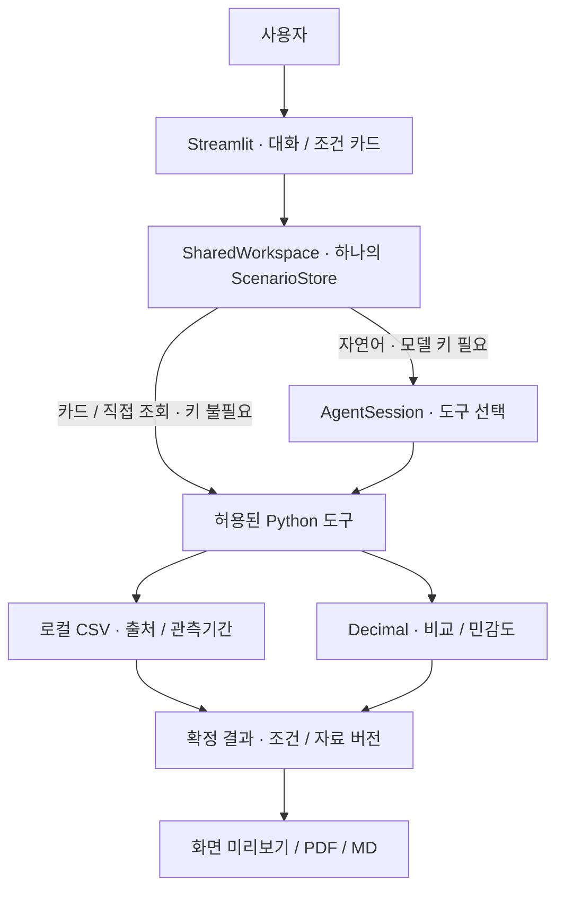

# 제주 감귤 출하 의사결정 Agent · 임준억 구현 현황

**`dev/juneok`의 MVP 체크포인트 [`354b2e9`](https://github.com/idenist/jeju-ai-agent-project/commit/354b2e93cbeee92b5afbec1287d78e371599e9de) 기준입니다.** 공통 `main`의 CSV·수집/전처리 위에 출하 비교 Agent와 사용 화면을 구현했습니다. 팀 최종 통합본이 아니라 중간발표·팀 검토용 개인 후보입니다.

사용자가 제공한 **물량·제시가격·비용·보관기간·감모 가정**으로 즉시 출하와 보관 후 출하를 비교하고, 기다리려면 필요한 최소단가와 가정별 금액 차이를 설명합니다. 미래가격을 예측하거나 최적 출하일·실제 수익을 보장하지 않습니다. [도구·계산 계약](docs/임준억/안내/도구와상태계약.md)

## 구현된 범위

| 구분 | 이 체크포인트에서 가능한 일 |
| --- | --- |
| 대화·조건 카드 | 같은 조건·버전으로 입력/수정. 모름과 0을 구분하고 기간 변경 시 감모 재확인 |
| 출하 대안 비교 | 최대 3개 보관 대안, 수수료 차감 전/후·포함 비용·별도 비용을 구분한 Decimal 계산 |
| 자료 조회 | #855 과거 월별 출하량과 동일 거래규격 경매가격을 각각 조회. 미관측은 NO_DATA |
| 가정 범위 비교 | 사용자가 정한 감모·미래단가 목록의 최대 49조합. 원래 조건은 유지 |
| 결과 공유 | 같은 확정 결과의 미리보기·한글 PDF, 보조 Markdown. 조건·출처·제약·부분 실패 표시 |
| 자료 관리 | 지원 경매 원본 CSV의 검사 → 변경 미리보기 → 명시적 추가 적용·버전 관리 |

**354b2e9 이후의 종합 브리핑·비교 JSON 저장/복원·판단 조건 설명 확장은 이 원격 체크포인트에 포함되지 않습니다.** 다른 팀원의 Agent나 과거 두 시점 가격 비교 도구를 통합한 상태도 아닙니다. [팀 통합 검토](docs/임준억/인수/팀통합검토.md)

## 구조와 하네스



모델은 요청을 해석하고 확인 질문·도구를 선택합니다. **하네스는 모델이 아니라 Python 코드**로, 조건 버전·원자 갱신(오류 시 기존 조건 유지)·입력 철회·기간별 감모 재확인·오래된 결과 차단·오류 복구·도구 종료를 통제합니다. 모델 호출은 턴당 최대 6회, 도구는 최대 12회로 제한하며 SDK 타임아웃과 턴 경과시간 검사를 둡니다. 계산·조회 수치는 모델의 자유 문장 대신 도구 결과로 표시합니다. [하네스 구현](agents/juneok/agent.py) · [공유 상태](agents/juneok/workspace.py)

```text
app.py                         # 공유 화면 진입점
agents/juneok/                 # 개인 Agent·상태·계산·근거 조회·보고서
  agent.py / tools.py          # 하네스·허용 도구 계약
  state.py / workspace.py      # 조건·이력·버전·대화/카드 연결
  comparison.py / sensitivity.py / evidence.py
  reporting.py / pdf_report.py # 같은 결과의 미리보기·PDF
scripts/                       # 공통 수집/전처리 + 개인 평가·진단·배포
data/                          # 아래 데이터 표 참조
```

`tests/test_juneok_*.py`는 개인 회귀, `evals/juneok_cases.json`은 모델 평가 과업, `docs/임준억/`은 개인 계획·검증·인수·작업기록입니다. 기존 공통 전처리 안내와 개인 문서를 분리했습니다.

## 데이터: main에서 받은 것과 추가한 것

| 구분 | 내용·실제 관측범위 | Git clone에 포함? |
| --- | --- | --- |
| 공통 main · 필수 데이터 | [제주데이터허브 #855](https://www.jejudatahub.net/data/view/data/855), 신고소별 감귤류 및 만감류 출하량 통계. 2018-01-01~2025-09-17, 마지막 월은 부분 집계 | 원본·일/월 집계·품질 보고서 포함 |
| 공통 main · 외부 데이터 | [전국 공영도매시장 경매원천정보 API](https://www.data.go.kr/data/15141810/openapi.do)에서 수집한 가락시장 감귤 CSV. 2026-10-01~11-03 | 원본·규격별 가격·품질 보고서 포함 |
| 개인 추가 수집 | **같은 경매 API**의 별도 스냅샷 `market-through-20261108`. 조회는 11-08까지, 마지막 유효 관측은 **11-06** | 미포함. 로컬 artifacts에 보관, 당시 인수 ZIP에는 동봉 |
| 사용자 입력·가정 | 제시가격·물량·비용·기간 전체 감모·저장/출하일 변경 가능성 | 예시 외 실제 농가 자료는 확보하지 않음 |

새 데이터 공급처를 추가한 것은 아닙니다. **공통 CSV를 덮어쓰지 않고 같은 경매 원천의 관측기간을 늘렸습니다.** 새 clone은 기본적으로 공통 자료를 사용하므로 로컬 개발 PC·동결 인수 ZIP과 가격 관측범위가 다를 수 있습니다. 실행 화면의 자료 버전·실제 관측일을 기준으로 확인하세요. [공통 스냅샷·해시](data/metadata/juneok_manifest.json) · [추가 수집·CSV 검증 기록](docs/임준억/검증/2026-11-09_데이터와민감도.md)

Agent의 실행 중 조회는 **CSV**입니다. 경매 API는 운영자의 선택적 사전 수집용이며, 자연어 처리만 외부 모델 API를 사용합니다. 경락가격은 농가 실수취가격이 아니고 과거 출하량은 현재 공급량이 아닙니다. 두 자료의 품종 분류·관측기간을 임의로 연결하지 않습니다. 개별 데이터 이용·재배포 조건의 최종 확인은 남아 있습니다.

## 처음 실행하는 팀원

Windows의 **Python 3.13 x64와 Python launcher**를 준비하고 프로젝트 루트에서 실행합니다. 최초 설치에는 패키지 저장소 접근이 필요합니다. 이미 가공 CSV가 있으므로 전처리·추가 수집부터 할 필요는 없습니다.

```powershell
git clone --branch dev/juneok https://github.com/idenist/jeju-ai-agent-project.git
cd jeju-ai-agent-project
.\setup-center.cmd
.\run-juneok.cmd
```

설치는 `.venv`에 `requirements-juneok.lock`을 적용하고 `.env`가 없을 때만 `.env.example`을 복사합니다. 화면은 `127.0.0.1`에서 실행됩니다.

| 설정 | 필요한 과업 |
| --- | --- |
| OPENAI_API_KEY | 자연어 대화. 로컬 `.env`에 입력하며 Git에 포함하지 않음 |
| OPENAI_MODEL | 배포 예시·검증 모델 `gpt-6-luna`. 미설정 시 코드 기본값은 `gpt-5-mini`이므로 명시 권장 |
| DATA_GO_KR_KEY | 운영자의 경매 API 사전 수집만 해당. 카드·CSV 조회·PDF에는 불필요 |

OS 환경변수가 `.env`보다 우선합니다. 키 값은 문서·영상·로그에 넣지 않습니다. [상세 설치·운영·복구](docs/임준억/인수/운영자인수매뉴얼.md)

**키 없이 첫 흐름 확인:** `가상 예시 조건 불러오기` → 최소 **3,109원/kg** → 감모 2%를 4%로 수정 후 `입력 조건 비교` → **3,174원/kg** → PDF 저장. 물량 3,000kg·현재 3,000원/kg·7일·하루 보관비 20,000원의 **가상 조건**이며 나머지 비용 기준은 예시와 같습니다. 이후 가정 범위·과거 출하통계도 조회할 수 있습니다. [사용자 매뉴얼](docs/임준억/인수/사용자매뉴얼.md) · [시연 대본](docs/임준억/인수/시연진행안.md)

## 검증 상태와 팀에 남긴 판단

| 확인한 범위 · 354b2e9 기준 | 확인하지 못한 범위 |
| --- | --- |
| 분리 인수본 **140개 회귀 통과**, 키 없는 시연 12개·자동 UI 8개 기준 통과 | 실제 농가·비전문가 참여자 0명. 이해도·시간 절감·수익 효과 미검증 |
| 실제 모델 기존 25/25, 대화→카드→대화→PDF 교차 흐름 6개 기준 통과 | 사람 리허설·팀 인수/채택 미실시 |
| 새 환경·단일 논리 CPU·키/HTTP 없는 CSV/UI/PDF의 공개 사양 기반 재현 | 실제 센터 장비·계정·네트워크에서 실행한 기록 없음 |

자동 검사·AI 역할별 검토는 실제 농가·팀원 검수를 대신하지 않습니다. 당시 실행 로그·ZIP은 Git 제외 산출물이며, 검사 코드·평가 정의와 아래 검증 문서는 이 커밋에 포함했습니다. 로컬 원시 로그 경로가 새 clone에도 있다고 해석하지 마세요. [140개·인수/시연 검증](docs/임준억/검증/2026-11-09_팀인수와시연준비.md) · [모델·공유 상태/PDF 검증](docs/임준억/검증/2026-11-09_공유상태와PDF.md) · [공개 사양 검증](docs/임준억/검증/2026-11-09_공개사양과업무적합성.md)

팀 대표 계산기·하네스·화면 선택, 정현 과거가격 도구 연결, 역할·최종 통합은 **중간발표 이후 합의 항목**입니다. 다른 팀원의 기능을 채택·대체했다고 표시하지 않습니다. 공통 CSV·수집/전처리의 기여를 보존하고 개인 구현은 `agents/juneok/`에 분리했습니다. [팀 통합 검토](docs/임준억/인수/팀통합검토.md)

검사 재현은 설치 후 아래 명령으로 시작할 수 있습니다. 첫 두 명령은 실제 모델을 호출하지 않습니다.

```powershell
.\.venv\Scripts\python.exe -m scripts.doctor_juneok
.\.venv\Scripts\python.exe -m scripts.verify_juneok
# 실제 모델 평가는 비용 발생: .\.venv\Scripts\python.exe -m scripts.evaluate_juneok --live
```

더 읽기: [팀 인수 안내](docs/임준억/인수/팀인수안내.md) · [개인 문서 목차](docs/임준억/문서안내.md) · [경매 공통 전처리](docs/감귤_경매가격_전처리_실행안내.md) · [출하량 공통 전처리](docs/제주_감귤_출하량_전처리_실행안내.md)
