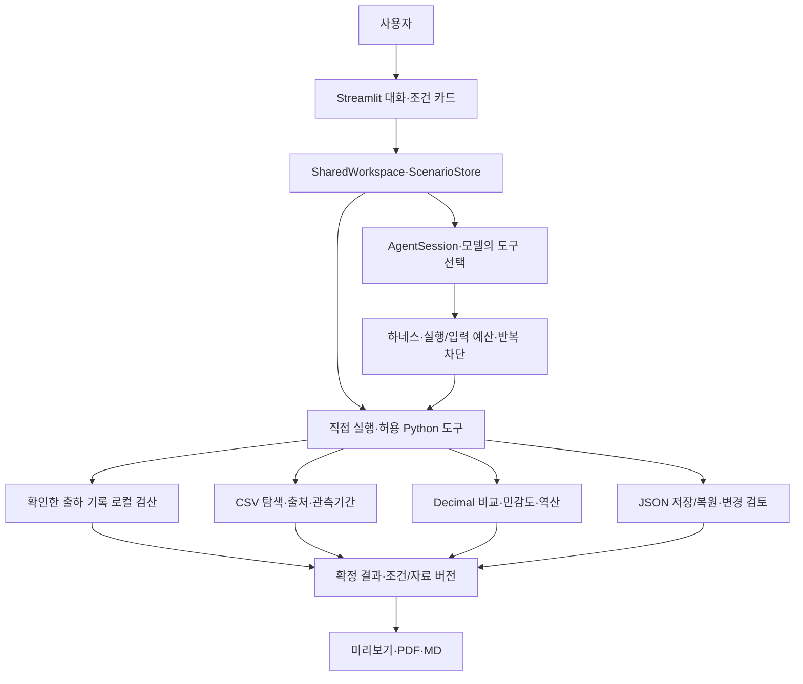

# 제주 감귤 출하 의사결정 AI Agent — 팀 통합 버전

**현재 개발 기준 브랜치: `integration/agents`.** 준억님의 Streamlit·계산·하네스, 정현님의 동일 거래규격 과거 경락가격 조회, 독립 베이스라인 검증을 통합한 개발 버전입니다. `main` 병합과 실제 농가 배포는 아직 승인되지 않았습니다. [STEP 8 인수 체크리스트](docs/통합_최종_인수_체크리스트.md)를 먼저 확인하세요.

확인한 입력 조건으로 손익분기를 계산하고, 실제 확보한 **과거 경락가격을 별도 조회**합니다. 과거 시장가격을 현재 농가 제시가격이나 미래 단가로 자동 적용하지 않습니다. **미래가격 예측·최적 출하일 자동 권고·실제 수익 개선을 검증한 서비스가 아닙니다.**

아래의 개인 발표·정산 상세 문서는 준억님 구현에서 이어온 이력입니다. 팀 전체의 현재 기능·검증 기준은 [통합 인수 체크리스트](docs/통합_최종_인수_체크리스트.md)와 [실제 모델 평가](docs/통합_실제모델_전체평가_결과_20261110.md)를 우선합니다.

**기존 개인 발표 자료:** [발표 대본](docs/임준억/인수/발표핵심대본.md) · [개인 결과 설명 PDF](docs/임준억/제출/결과설명자료_개인후보.pdf). 현재 팀 통합 결과에 대한 최종 발표·배포 검증 자료는 아니므로 구분해 사용하세요.

**바로가기:** [기능](#현재-가능한-일) · [시작](#빠른-시작) · [구조](#구조와-하네스) · [데이터](#데이터와-자료-버전) · [검증](#검증과-한계) · [다음 단계](#팀-합의와-다음-단계)

## 현재 가능한 일

| 사용자 과업 | 구현 내용 |
| --- | --- |
| 조건 입력·수정 | 대화와 Streamlit 카드가 같은 조건·버전을 사용. 모름/0 구분·철회·기간 변경 감모 재확인 |
| 자료 탐색·선택 | 실제 결합 거래규격·출하 품종/연월을 탐색하고 명시 선택 후 조회. 관측기간·품질·부분월·코드 모호성 표시 |
| 출하 대안 비교 | 최대3개 대안, 수수료 차감 전/후·포함/별도 비용을 구분한 Decimal 손익분기 계산 |
| 가정 비교·판단 설명 | 지정 감모/미래단가의 최대49조합. 원래 조건 유지·금액 차이·실행 제약 설명 |
| 허용 조건 역산 | 제안가격에서 감모 또는 전체 물량 하루 보관비를 한 변수씩 계산. 보수적 상한·가능한 해 없음 구분 |
| 종합 브리핑 | 선택한 #855·시장 참고·비교·가정을 묶고 누락/미관측은 부분 결과로 표시 |
| 비교 저장·변경 검토 | JSON v2 저장·v1/v2 읽기·명시적 복원. 복원 없이 저장/현재 조건 변경과 재계산 차이 검토 |
| 실제 출하·정산 | 원래 비교와 분리한 한 출하 기록·수정 이력·JSON 복원. 매출/공제/지급액·외부 비용·입금 검산과 입력/계산 근거를 대화·PDF·JSON에 연결 |
| 공유·자료 관리 | 같은 확정 결과의 미리보기·한글 PDF·보조 MD. 지원 경매 원본 CSV 검사→미리보기→명시 적용 |
| 과거 경락가격 | 동일 규격의 3·7·14일 과거 가격쌍 조회, 후속 조건 승계·철회, 키 없는 직접 조회 및 PDF 보고서 |

부분 출하·반품/추가 정산·원래 가정과 실제 결과의 금액 대조(C)·사용자 계정/장기 프로필은 미구현입니다. 정산은 수동 카드 확인 후 저장합니다. 카드 정산값·근거는 로컬 처리하고 모델 이력에는 금액 없는 처리 상태만 전달합니다. 직접 쓴 채팅과 기존 출하 비교 조건은 일반 모델 입력입니다. 정현님의 **과거 경락가격 조회는 통합**했지만, 과거 변동으로 만드는 B안 가정 단가 생성은 아직 통합 Agent에 자동 연결하지 않았습니다. [도구·상태 계약](docs/임준억/안내/도구와상태계약.md)

## 빠른 시작

Windows의 **Python 3.13 x64와 Python launcher**를 준비합니다. 가공 CSV가 포함되어 있어 추가 수집·전처리 없이 시작할 수 있습니다. 최초 설치에는 패키지 저장소 접근이 필요합니다.

```bat
git clone --branch integration/agents https://github.com/idenist/jeju-ai-agent-project.git
cd jeju-ai-agent-project
setup-center.cmd
run-juneok.cmd
```

설치는 `.venv`에 고정 lock을 적용하고 `.env`가 없을 때만 예시를 복사합니다. 앱은 `127.0.0.1`에서 실행됩니다.

| 설정 | 필요할 때 |
| --- | --- |
| `OPENAI_API_KEY` | 자연어 대화. 로컬 `.env`에 입력, Git/문서/영상에서 제외 |
| `OPENAI_MODEL` | 기본값·빈 설정 fallback은 `gpt-6-luna`. 명시한 다른 모델은 유지 |
| `DATA_GO_KR_KEY` | 운영자의 선택적 경매 API 사전 수집. CSV 조회·카드·PDF에는 불필요 |

OS 환경변수가 제품 `.env`보다 우선합니다. [설정 코드](agents/juneok/config.py) · [설치·운영·복구](docs/임준억/인수/운영자인수매뉴얼.md)

**키 없는 첫 여정:** 가상 예시 → 최소 **3,109원/kg** → 감모2%를4%로 수정 → **3,174원/kg** → PDF/JSON 저장. 물량3000kg·현재3000원/kg·7일·일 보관비20000원의 **가상 조건**입니다. 미래3300원 가정의 허용 감모는 보수 표시7.67%, 감모2%를 고정한 별도 계산의 일 보관비 상한은100285원입니다. 두 상한을 동시에 적용하는 조합은 아닙니다. [시연 대본](docs/임준억/인수/시연진행안.md)

## 구조와 하네스



모델은 요청 해석·확인 질문·도구 선택을 맡습니다. Python 하네스가 원자 갱신·철회·기간 재확인·오래된 결과 차단·실패 분류·부분 결과를 통제합니다. 동일 상태의 무진전 호출은2회 뒤 차단하고 기본 예산은 모델6회·도구12회·90초입니다. 최근4개 완결 사용자 턴과 직렬화 input32000자 안에서 최신 조건·과업 맥락을 제공합니다. 전체 프롬프트 토큰 한도나 로컬 도구 강제 종료 보장은 아닙니다. [하네스](agents/juneok/harness.py) · [과업 맥락](agents/juneok/task_context.py)

수치·보고서는 Python 결과를 사용합니다. 명시적 조회 선택과 가정을 보관하며 사용자 장기 프로필 DB는 없습니다. 탐색·역산·변경 검토는 현재 경제 입력을 자동 변경하지 않습니다.

<details>
<summary>개발자가 볼 파일 구조</summary>

```text
app.py                           # 대화·카드·직접 도구·공유 진입점
agents/juneok/
  agent.py / harness.py / tools.py / task_context.py
  state.py / workspace.py         # 조건·이력·공유 상태
  comparison.py / sensitivity.py / limits.py
  evidence.py / catalog.py / briefing.py / insights.py
  casefiles.py / case_changes.py  # JSON·읽기 전용 변경 검토
  settlement.py / settlement_ui.py / settlement_reporting.py
                                 # 분리한 출하 기록·정산·입력/계산 근거
  reporting.py / pdf_report.py    # 동일 결과의 미리보기·PDF
scripts/                         # 공통 전처리 + 개인 평가·진단·인수 빌드
tests/ / evals/                   # 회귀·한국어 평가 정의
docs/임준억/                     # 계획·검증·인수·작업기록·제출 초안
assets/fonts/ / assets/licenses/  # 글꼴·출처·외부 공지
```

</details>

## 데이터와 자료 버전

| 구분 | 사용 자료·실제 범위 | Git clone |
| --- | --- | --- |
| 공통 main·필수 | [제주데이터허브 #855](https://jejudatahub.net/data/view/data/855), 신고소별 감귤류/만감류 출하통계. 로컬 CSV 유효 날짜2018-01-01~2025-09-17 | 원본·일/월 집계·품질 보고서 포함 |
| 공통 main·외부 | [전국 공영도매시장 경매원천정보](https://www.data.go.kr/data/15141810/openapi.do)의 가락시장 감귤.2026-10-01~11-03 | 원본·규격별 가공본·품질 보고서 포함 |
| 개인 추가 수집 | 같은 경매 API의 별도 스냅샷. 조회11-08까지 중 마지막 유효 관측 **11-06** | artifacts로 Git 제외. 동결 인수 ZIP에는 선택 스냅샷 포함 |
| 사용자 입력 | 제시가격·물량·기간 감모·비용·실행 제약 | 예시 외 실제 농가 자료 미확보 |

**새 clone과 개발 PC/인수 ZIP의 관측범위는 다를 수 있습니다.** 실행 화면의 실제 관측일·자료 버전을 확인하세요. 공통 원본과 전처리를 유지하며 추가 수집으로 덮어쓰지 않았습니다. [공통 해시](data/metadata/juneok_manifest.json) · [수집·CSV 검증](docs/임준억/검증/2026-11-09_데이터와민감도.md)

실행 중 자료 조회는 **로컬 CSV**이며 데이터 API는 사전 수집용입니다. 경락가격은 농가 실수취가격이 아니고 #855는 과거 신고 출하량입니다. 품종/기간 자동 연결·미관측0 채우기·현재 공급 추정은 하지 않습니다.

경매는 공식 ‘이용허락범위 제한 없음’ 표시를 확인했습니다. #855 개별 재배포 범위는 미확인이고 공개 페이지의 수집기간 표시는 로컬 CSV와 달라 별도 기록했습니다. Python49개 배포본의 공지97개와 글꼴 OFL을 동봉합니다. [데이터 활용 명세](docs/임준억/제출/데이터활용명세.md) · [라이선스 목록](docs/임준억/제출/외부라이선스목록.md)

## 검증과 한계

| 확인한 범위 | 결과와 한계 |
| --- | --- |
| 금액·상태·자료 | 독립 정답, 미확인/0·이중 차감·철회/버전·미관측·원래 비교 불변 검사 |
| 저장·근거·정산 대화 | 잘못된 파일/근거 거부·수치/ID 복원 일치·후속 모델 요청에서 카드 상세 정산값 제외 |
| 자동 회귀 | STEP 6-2까지 508개 로컬 통과 기록. STEP 7과 인수 테스트 추가 후에는 **최신 통합 전체 회귀를 재실행**해야 하며, 이전 개인 수치를 현재 검증으로 대체하지 않음 |
| 통합 모델 평가 | 2026-11-10 `gpt-6-luna` 실제 API의 12문항·16턴 1회 자동 채점 12/12 통과. INT-04 명시 조건 누락 등 수동 검토 한계가 있음 |
| 개인 이력/이동 실행 | 준억님 개인 패키지·정산 검증 기록과 최종 통합 인수 검증을 구분. 통합 최종 점검은 `scripts.verify_integration_handoff` 사용 |
| 남은 실증 | 실제 농가/비전문가0명, 사람 리허설·수익 효과·팀 채택·실제 센터 장비 실행 미확인 |

[발표 정리 검증](docs/임준억/검증/2026-11-09_발표흐름과로컬정산정리.md)에서 현재 계약을 확인합니다. [A+B 최초 검증](docs/임준억/검증/2026-11-09_실제출하와정산검산.md)과 [이전 제품 검증](docs/임준억/검증/2026-11-09_자료탐색과역산및변경검토.md)의 모델 반복/오류·재시도 기록은 당시 소스로 구분해 보존합니다. **원시 로그·ZIP은 Git 제외 artifacts 산출물**이며 새 clone에는 없습니다. PDF2종은 위 docs 경로에 동봉했고 원문 Markdown·생성 코드도 포함합니다.

```bat
.\.venv\Scripts\python.exe -m scripts.verify_integration_handoff --full
REM 아래는 기존 준억님 개인 기능 검증용 명령입니다.
.\.venv\Scripts\python.exe -m scripts.doctor_juneok
.\.venv\Scripts\python.exe -m scripts.verify_juneok
.\.venv\Scripts\python.exe -m scripts.prepare_juneok_product_demo
# 정산 가상 PDF/JSON: python -m scripts.prepare_juneok_settlement_demo
# 정산 관련 유료 모델 확인: python -m scripts.verify_juneok_settlement_live --repeat 1
# 기존 제품 유료 모델 평가: python -m scripts.verify_juneok_product_expansion_live --repeat 3
```

기획서8페이지·결과 설명자료5페이지의 개인 초안과 데이터 활용 명세를 준비했습니다. PDF·인수 ZIP 재생성은 [운영자 매뉴얼](docs/임준억/인수/운영자인수매뉴얼.md)을 따릅니다. 공개 센터 사양 기반 로컬 재현을 실제 센터 장비 실행으로 표시하지 않습니다.

## 팀 합의와 다음 단계

`integration/agents`에는 준억님 UI·계산·정산과 정현님 과거 경락가격 조회가 연결되어 있습니다. 정현님의 B안 가정단가 도구는 독립 모듈로만 보존합니다. 실제 사용자 검증, INT-04/INT-11 안내 개선, #855 이용조건 검토 및 팀의 명시적 승인은 **`main` 병합·대외 배포 전에 별도로 확인**해야 합니다. [STEP 8 체크리스트](docs/통합_최종_인수_체크리스트.md) · [기존 팀 통합 검토](docs/임준억/인수/팀통합검토.md)

농가 실용성·사람 리허설·#855 개별 이용조건 확인은 병행 과업입니다. 다른 작물·부분 출하·생애주기·장기 프로필은 [확장 방향](docs/임준억/계획/확장방향.md)에 보존합니다. 다음 개발은 사용자 과업·자료·검증 기준을 정한 뒤 진행합니다.

[개발계획](docs/임준억/계획/개발계획.md) · [작업기록](docs/임준억/작업기록/목차.md) · [문서 목차](docs/임준억/문서안내.md) · [경매 공통 전처리](docs/감귤_경매가격_전처리_실행안내.md) · [출하량 공통 전처리](docs/제주_감귤_출하량_전처리_실행안내.md)
