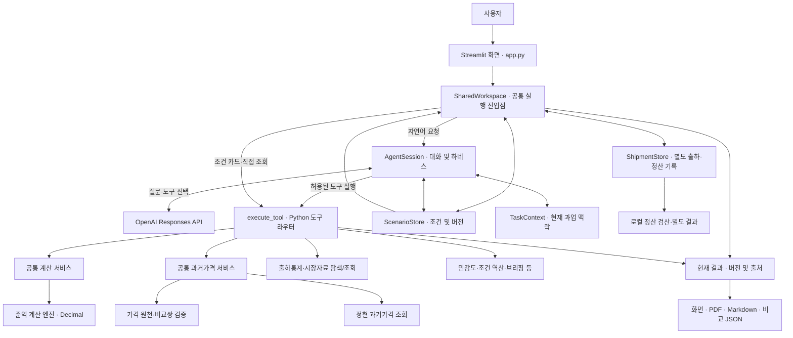

# 02. 시스템 아키텍처

> **제주 감귤 출하 의사결정 AI Agent — 팀 통합 개발본**\
> 기준일: 2026-11-11 · 브랜치: `integration/agents` · **기능 코드 점검 기준:** [`6517565`](https://github.com/idenist/jeju-ai-agent-project/commit/65175656e637d576056da76d5915287a2a68a84e)\
> 관련 문서: [01. 프로젝트 개요 및 현황](01_프로젝트_개요_및_현황.md)

## 1. 설계 개요

현재 시스템은 **단일 대화 Agent + Python 도구·계산 서비스 + 공통 작업 상태 + Streamlit 화면**으로 구성됩니다. 이 문서는 클래스 이름보다 각 부분이 맡은 일과 실제 사용자 요청의 흐름을 먼저 설명합니다. 자연어 요청의 해석과 도구 선택은 모델이 담당하고, 조건 변경·데이터 조회·수치 계산·결과 저장은 Python 코드가 수행합니다.

쉽게 말해 **`SharedWorkspace`는 화면의 공통 작업공간**, **`AgentSession`은 AI 대화 실행부**, **`ScenarioStore`는 출하 비교조건 저장소**입니다. 이어지는 2장에서 각 객체를 예시와 함께 설명합니다.

각 팀원이 개발한 코드를 독립된 Agent 세 개로 상시 실행하는 구조는 아닙니다. **준억님의 `AgentSession`이 활성 대화 진입점**이며, 정현님의 과거 경락가격 조회 코드를 공통 서비스로 연결했습니다. 승혁님의 초기 계산 베이스라인은 독립 검산·회귀 테스트 자산으로 남아 있습니다.

## 2. 주요 구성요소: 이름보다 역할부터 이해하기

코드에 등장하는 `SharedWorkspace`, `AgentSession`, `ScenarioStore`는 **서로 다른 역할을 가진 Python 클래스**입니다. 이름이 비슷해 보여도 각각이 하는 일은 다릅니다.

### 2.1 가장 중요한 다섯 객체

| 객체 | 한마디로 | 맡은 일 | 실제 예시 |
|---|---|---|---|
| **`SharedWorkspace`** | 화면과 기능을 연결하는 **작업공간** | 대화·조건 카드·직접 자료 조회를 같은 작업 흐름으로 묶고, 화면에 보여줄 최신 결과를 보관 | 대화로 입력한 조건을 카드에도 보여주고, 계산 결과를 PDF·JSON 출력에 전달 |
| **`AgentSession`** | AI 대화의 **실행 담당자** | 사용자 질문을 모델에 보내고, 모델이 선택한 도구를 Python으로 실행하며, 실행 결과와 대화 이력을 관리 | “7일 보관하면?”이라는 질문에 모델이 비교 도구를 선택하면 실행까지 이어감 |
| **`ScenarioStore`** | 출하 비교조건의 **원본 보관소** | 물량·현재가격·보관기간·감모율·비용·대안과 변경 버전을 저장 | 현재 조건이 ‘3,000kg, 7일, 감모 2%’라는 사실을 보관 |
| **`TaskContext`** | 지금 진행 중인 **질문의 맥락** | 이번 대화에서 무엇을 알아보는 중인지, 어떤 조회조건을 선택했고 무엇이 부족한지 기록 | “아까 그 시장 자료에서 14일로 바꿔줘”의 과업 맥락을 이어감 |
| **`ShipmentStore`** | 출하 후 **실제 기록 보관소** | 출하 전 계획과 연결된 실제 출하·판매·정산 입력 및 수정 이력을 관리 | 계획 비교와 별개로 정산서 매출·공제·입금을 기록 |

이 중 가장 헷갈리기 쉬운 세 객체의 차이는 다음과 같습니다.

**`ScenarioStore`는 '현재 조건이 무엇인가'에 답합니다.** 예를 들어 3,000kg을 7일 보관하고 감모율을 2%로 가정했다는 값 자체를 저장합니다. 조건을 바꾸면 `version`이 갱신되고, 이전 조건과 입력 출처도 추적합니다. 구현 파일은 [`agents/juneok/state.py`](../agents/juneok/state.py)입니다.

**`AgentSession`은 'AI에게 무엇을 요청하고 어떤 도구를 실행할 것인가'를 맡습니다.** `ScenarioStore`를 내부에 가지고 있으며, 질문을 보낼 때 현재 저장된 조건을 함께 모델에 제공합니다. 모델이 도구 호출을 선택하면 Python 함수를 실행하도록 연결합니다. 구현 파일은 [`agents/juneok/agent.py`](../agents/juneok/agent.py)입니다.

**`SharedWorkspace`는 '사용자가 어느 화면에서 작업하든 같은 조건과 결과를 어떻게 사용할 것인가'를 담당합니다.** 대화 요청은 `AgentSession`에 전달하고, 조건 카드에서 직접 입력한 내용은 동일한 `ScenarioStore`에 적용합니다. 실행된 도구의 결과는 `entries`에 모아 화면·보고서에서 사용합니다. 구현 파일은 [`agents/juneok/workspace.py`](../agents/juneok/workspace.py)입니다.

즉, `SharedWorkspace`는 계산 엔진이나 LLM이 아닙니다. **화면과 실제 기능을 연결하는 조정 계층**입니다. `AgentSession`도 LLM 모델 자체가 아니라, **외부 모델을 호출하고 응답을 실제 Python 작업으로 이어 주는 코드**입니다.

### 2.2 실제로 어떻게 연결되어 있나요?

`app.py`의 `_workspace()`는 Streamlit 세션에 `SharedWorkspace`를 만들어 보관하고, 다음 화면 갱신에서도 같은 객체를 사용합니다. 주요 객체의 관계는 아래와 같습니다.

```text
app.py (Streamlit 화면)
└─ SharedWorkspace
   ├─ AgentSession                     ← 대화·모델 호출·도구 실행
   │  ├─ ScenarioStore                 ← 출하 비교조건과 버전
   │  ├─ TaskContext                   ← 현재 과업 및 미확인 조건
   │  └─ price_history_query           ← 앞서 명시한 과거가격 조회조건
   ├─ entries                           ← 화면에 표시할 현재 도구 결과
   └─ ShipmentStore                     ← 별도 실제 출하·정산 기록
```

중요한 점은 **조건 보관소를 두 개 만든 것이 아니라는 것**입니다. `SharedWorkspace.store`는 `AgentSession.store`를 그대로 참조합니다. 그래서 대화로 조건을 바꾼 뒤 조건 카드에서 확인할 수 있고, 카드에서 바꾼 조건을 다음 대화에도 사용할 수 있습니다.

예를 들어 “과거 가격 비교 간격을 7일에서 14일로 바꿔줘”라는 질문은 출하 보관 대안의 기간을 바꾸는 요청과 다릅니다. 과거가격 조회에서 앞서 사용한 인수는 `AgentSession.price_history_query`가 관리하며, 출하 비교조건은 `ScenarioStore`가 관리합니다. 이를 구분하는 이유는 두 종류의 숫자가 서로 다른 업무를 나타내기 때문입니다.

### 2.3 모델에서 계산 결과까지 연결하는 코드

위 객체들이 조건과 대화를 담당한다면, 실제 기능은 다음 모듈들이 수행합니다.

| 구성요소 | 하는 일 | 실제 코드 |
|---|---|---|
| **`tools.py`** | 모델에 제공할 도구 목록·입력 형식을 정의하고, 도구 이름에 맞는 Python 함수를 호출 | [`TOOLS`, `execute_tool()`](../agents/juneok/tools.py) |
| **`harness.py`** | 한 요청의 호출 횟수·시간·대화 길이·반복 호출을 관리 | [`ExecutionPolicy`, `RepeatGuard`](../agents/juneok/harness.py) |
| **공통 계산 서비스** | 손익 계산 요청을 준억님의 선택된 계산 엔진으로 전달하고 반환 상태를 확인 | [`calculation_service.py`](../agents/common/calculation_service.py) |
| **공통 과거가격 서비스** | 자료를 검증한 뒤 정현님의 가격 조회 코드를 실행하고 공통 상태로 변환 | [`price_history_service.py`](../agents/common/price_history_service.py) |
| **표시·보고서 코드** | Python 도구가 반환한 숫자와 설명을 화면용 텍스트·PDF·JSON으로 구성 | [`reporting.py`](../agents/juneok/reporting.py), [`pdf_report.py`](../agents/juneok/pdf_report.py), [`casefiles.py`](../agents/juneok/casefiles.py) |

여기서 **도구(tool)**는 모델이 *사용하자고 선택할 수 있는 Python 기능*입니다. 예를 들어 모델이 `compare_shipment_options`라는 도구 이름과 인수를 반환하더라도, 손익 계산을 수행하는 것은 모델이 아니라 Python의 `execute_tool()`과 계산 서비스입니다.

### 2.4 전체 구조를 한 번에 보기



앞에서 소개한 객체와 실제 업무 모듈의 연결을 요약한 그림입니다. 도식은 책임과 호출 경로를 간략화한 것입니다. 실제 화면 출력은 `SharedWorkspace`에 저장된 결과와 버전 검사를 거쳐 구성되며, 모델 응답과 Python 계산값은 서로 다른 출처로 다룹니다.


## 3. 사용자 요청은 실제로 어떻게 처리될까요?

### 3.1 자연어 대화 예시: 7일 보관의 손익분기 가격

다음은 앱에 포함된 **가상 예시 조건**을 불러온 상태를 가정한 설명입니다.

| 확인된 조건 | 값 |
|---|---|
| 출하 물량 | 3,000kg |
| 현재 단가 | 3,000원/kg (수수료 차감 후 기준) |
| 지연 기간 | 7일 |
| 기간 전체 감모율 | 2% |
| 하루 보관비 | 20,000원 |
| 기타 비용 | 양쪽 동일하여 비교에서 제외하는 예시 조건 |

사용자가 **“7일 보관하려면 최소 얼마를 받아야 하나요?”**라고 입력했다고 해보겠습니다.

1. **`app.py`가 질문을 받습니다.** 채팅 입력이 제출되면 `SharedWorkspace.run(질문)`을 호출합니다. 화면은 질문을 받아 전달하는 역할입니다.
2. **`SharedWorkspace`가 `AgentSession.run()`에 질문을 넘깁니다.** 이때 두 객체가 참조하는 출하 비교조건은 같은 `ScenarioStore`에 있습니다.
3. **`AgentSession`이 모델에 필요한 정보를 보냅니다.** 질문과 함께 `ScenarioStore`의 현재 조건, `TaskContext`의 진행 맥락 등을 제공합니다. 모델은 어떤 도구가 필요한지 판단합니다.
4. **모델이 손익 비교 도구를 선택하면** `AgentSession`이 호출 인수를 확인하고 `execute_tool("compare_shipment_options")`로 연결합니다. 이 단계부터 계산은 Python이 처리합니다.
5. **계산 서비스가 실제 숫자를 계산합니다.** `agents/common/calculation_service.py`를 거쳐 `agents/juneok/comparison.py`의 `Decimal` 계산이 실행됩니다. 위 예시에서는 손익분기 단가가 약 **3,109원/kg**입니다.
6. **결과가 다시 화면으로 돌아옵니다.** `AgentSession`은 실행 결과를 모으고, `SharedWorkspace`는 결과를 현재 조건·자료 버전과 연결하여 보관합니다. `app.py`는 이를 화면과 보고서로 표시합니다.

이 과정에서 모델의 주된 역할은 **사용자 질문을 해석하고 적합한 도구를 선택하는 것**이며, 금액의 계산과 최종 표시 자료는 Python 결과에 근거합니다. 위 도구 선택은 구조를 설명하기 위한 예시이며, 실제 모델의 호출 과정은 요청에 따라 달라질 수 있습니다.

```text
질문: “7일 보관하려면 최소 얼마를 받아야 하나요?”
  → app.py: 채팅 입력 접수
  → SharedWorkspace.run(): 공통 작업공간에서 대화 처리 요청
  → AgentSession.run(): 현재 조건을 붙여 모델 호출
  → 모델: compare_shipment_options 선택 (예시)
  → execute_tool(): 허용된 Python 도구 실행
  → calculation_service.py → comparison.py: 손익분기 계산
  → SharedWorkspace.entries: 계산 결과 보관
  → app.py: 화면·보고서 표시
```

### 3.2 조건 카드로 직접 비교하면 무엇이 다른가요?

조건 카드의 입력은 모델을 거칠 이유가 없습니다. 사용자가 물량·감모·비용을 직접 확인하고 **입력 조건 비교**를 실행하면 같은 Python 계산 서비스로 연결됩니다.

```text
조건 카드의 입력 확정
  → SharedWorkspace.apply_card(): 카드 입력을 비교조건으로 변환
  → ScenarioStore.update(): 조건 저장 및 버전 갱신
  → SharedWorkspace.calculate(): 계산 요청
  → execute_tool("compare_shipment_options")
  → 공통 계산 서비스 → Decimal 계산 엔진
  → SharedWorkspace.entries → 화면·PDF·JSON
```

**차이는 진입 방식뿐입니다.** 자연어 입력은 `AgentSession`이 모델과 도구 호출을 조정하고, 조건 카드는 `SharedWorkspace`가 바로 도구를 호출합니다. 두 경로 모두 같은 `ScenarioStore`의 확인된 조건과 같은 계산 엔진을 사용합니다.

### 3.3 과거 경락가격을 물으면 어떤 경로를 타나요?

“조생귤·특·소·상자 5kg의 과거 7일 간격 경락가격”처럼 가격 조회를 요청하면 손익 계산 대신 `get_price_history` 도구를 사용합니다.

```text
자연어 질문 또는 화면의 과거가격 직접 조회
  → 조회조건 정리 (품종·등급·크기·포장·중량·간격)
  → 공통 과거가격 서비스
  → 가격 원천과 가격쌍 파일 검증
  → 정현님 과거가격 조회 함수 실행
  → 결과·품질 정보 정리
  → SharedWorkspace.entries → 화면·과거가격 보고서
```

자연어에서 “아까 조건 그대로 14일로 바꿔줘”라고 하면 `AgentSession.price_history_query`에 남은 **이전 명시 조회조건**과 새 입력을 합칩니다. 모호한 품종이나 충돌한 포장중량은 별도의 확인 항목으로 반환합니다. 화면의 직접 조회는 새 조회로 시작합니다.

---

## 4. 핵심 업무 서비스의 연결

### 4.1 출하 손익 계산

손익 계산의 서비스 진입점은 [`agents/common/calculation_service.py`](../agents/common/calculation_service.py)의 `compare_shipment_options()`입니다.

```text
도구 라우터 / 직접 비교
  → common.calculation_service.compare_shipment_options()
  → juneok.comparison.compare_shipment_options()
  → 공통 응답 상태 확인
  → 원래 계산 결과 반환
```

실제 계산은 준억님의 [`comparison.py`](../agents/juneok/comparison.py)에서 `Decimal` 기반으로 수행합니다. 수수료, 보관비, 감모, 별도 비용 등 확장된 입력을 지원하며, **승혁님의 [`baseline.py`](../agents/baseline.py)는 테스트에서 독립적으로 비교**합니다. 운영 중에 두 엔진을 동시에 실행해 결과를 선택하는 구조는 아닙니다.

민감도 비교와 조건 역산은 각각 [`sensitivity.py`](../agents/juneok/sensitivity.py), [`limits.py`](../agents/juneok/limits.py)에 구현되어 있으며, 같은 시나리오 상태를 기준으로 실행됩니다. 계산식·단위·비용 처리의 상세 규약은 [03. 데이터 및 계산 명세](03_데이터_및_계산_명세.md)에서 정리합니다.

**현재 비교 기준:** 계산 엔진은 0일의 현재 판매금액을 기준으로 각 보관 대안의 손익분기와 차액을 반환합니다. 두 보관 대안(예: 3일 뒤 A와 10일 뒤 B)의 *상대 차액과 상대 손익분기 가격*을 직접 반환하는 기능은 아직 별도로 구현되어 있지 않습니다. 이를 기존 계산 결과를 재사용하는 비교 계층으로 추가할지는 [06. 향후 개발 계획](06_향후_개발계획.md)에서 다룹니다.

### 4.2 동일 규격 과거 경락가격

정현님의 가격 조회 함수는 [`agents/common/price_history_service.py`](../agents/common/price_history_service.py)를 통해 활성 Agent와 직접 조회 화면에 연결됩니다.

```text
대화 또는 직접 과거가격 조회
  → 조회조건 확인·후속 조건 처리
  → execute_tool("get_price_history")
  → get_integrated_price_history()
  → data_contract.verify_integrated_price_sources()  [조회 전]
  → jeonghyeon.price_history의 조회 코드
  → data_contract.verify_integrated_price_sources()  [조회 후]
  → result_contract의 공통 상태 변환
  → 화면·과거가격 보고서
```

조회 시 원천 가격 CSV와 비교쌍 파일의 **해시·전체 내용 일치 여부**를 점검합니다. 품종, 등급, 크기, 포장, 포장당 중량, 시장·거래방식 등의 동일 조건을 기준으로 과거 3·7·14일 가격쌍을 찾습니다.

자연어 후속 질문에서는 [`price_history_followup.py`](../agents/common/price_history_followup.py)가 이전에 사용자가 명시한 조건을 승계합니다. 최신 코드에는 **품종이 미확정이어도 나머지 입력값을 유지하는 처리**와 **포장중량 충돌 확인**이 포함되어 있습니다. 직접 조회 화면에서는 별도로 새 조회조건을 수집합니다.

정현님의 [`price_scenario.py`](../agents/jeonghyeon/price_scenario.py)는 과거 변동을 가정 단가로 변환하는 독립 모듈로 보존되어 있으며, 활성 도구 목록에는 과거가격 **조회 기능**이 연결되어 있습니다.

### 4.3 다른 자료 및 분석 기능

| 처리 영역 | 모듈 | 호출 예시 |
|---|---|---|
| 제주 과거 출하량·시장 참고가격 | [`evidence.py`](../agents/juneok/evidence.py) | `get_historical_shipment_context`, `get_market_evidence` |
| 보유 자료와 거래규격 탐색 | [`catalog.py`](../agents/juneok/catalog.py) | `explore_data` |
| 조건부 손익 민감도 | [`sensitivity.py`](../agents/juneok/sensitivity.py) | `compare_sensitivity` |
| 제안가격의 허용 조건 역산 | [`limits.py`](../agents/juneok/limits.py) | `solve_offer_limits` |
| 자료·가정 종합 검토 | [`briefing.py`](../agents/juneok/briefing.py) | `build_review_brief` |
| 판단 조건과 결과 해석 | [`insights.py`](../agents/juneok/insights.py) | `explain_decision_conditions` |
| 비교 저장본과 현재 조건 대조 | [`case_changes.py`](../agents/juneok/case_changes.py) | `review_case_changes` |

모든 도구는 [`execute_tool()`](../agents/juneok/tools.py)의 허용 목록을 통해 실행됩니다. 직접 화면 조작은 같은 Python 도구와 서비스에 접근하며, 실행 결과를 `SharedWorkspace`가 공유합니다.

## 5. 상태·결과 관리

현재 구현에서는 **조건, 과업 맥락, 최신 결과, 실제 출하 기록**을 구분해 관리합니다.

| 데이터 | 소유 객체 | 역할 |
|---|---|---|
| **비교조건** | `ScenarioStore` | 물량·현재가격·비용·보관 대안, 버전(`version`), 변경 이력·입력 출처(`provenance`) |
| **대화 및 명시 조회조건** | `AgentSession` | 모델 대화 이력, 이전 과거가격 조회 인수, 해당 데이터 버전 |
| **현재 과업 맥락** | `TaskContext` | 선택한 출하·시장 조회조건, 민감도 가정, 확인할 항목 |
| **현재 출력 결과** | `SharedWorkspace.entries` | 채널별 Python 도구 결과, 조건 버전·자료 버전과 연결된 화면 출력 |
| **실제 출하·정산** | `ShipmentStore` | 계획 기준에 연결된 별도 출하 기록과 정산 수정 이력 |

**조건 변경:** `ScenarioStore.update()`는 `expected_version`이 현재 버전과 일치할 때 변경을 적용합니다. `null` 유지와 명시적 철회를 구별하고, 보관기간이 달라지면 그 기간의 감모율을 다시 확인하도록 처리합니다. 여기서 *조건 버전*은 사용자의 비교 입력이 변경된 횟수를 구별하는 번호입니다.

**결과 유효성:** `SharedWorkspace.current_entries()`는 계산 시점의 조건 버전과 현재 버전, 자료 버전을 대조합니다. 조건이나 사용 자료가 달라진 상태의 결과는 최신 화면 결과로 취급하지 않습니다.

**작업 연속성:** `TaskContext`는 현재 검토의 목적, 선택한 출하·시장 조건과 미확인 항목을 관리합니다. 과거 경락가격의 “14일로 바꿔 주세요” 같은 후속 질문은 별도로 `AgentSession.price_history_query`에 보관된 **이전 명시 입력**과 결합해 처리합니다.

**별도 정산:** `ShipmentStore`는 당시 계획의 스냅샷을 연결한 후 실제 판매·공제·입금 기록을 별도로 관리합니다. 정산 금액은 로컬 UI·보고서에서 검산하며, 모델에는 처리 상태 중심의 [`model_receipt()`](../agents/juneok/settlement.py)가 전달됩니다.

## 6. 입력·출력과 데이터 경계

### 6.1 자료 흐름

```text
data/raw/ 원본 자료
  ├─ scripts/preprocess_auction.py
  │    └─ data/processed/daily_prices.csv
  │         └─ scripts/build_price_comparisons.py
  │              ├─ data/processed/price_comparisons.csv
  │              ├─ data/processed/price_comparison_availability.csv
  │              └─ data/reports/price_comparison_report.json
  └─ scripts/preprocess_shipments.py
       ├─ data/processed/daily_shipments.csv
       └─ data/processed/monthly_shipments.csv
```

위 파일들은 저장소에 포함된 가공 자료를 기준으로 합니다. 경매 자료를 추가 갱신할 때는 [`data_refresh.py`](../agents/juneok/data_refresh.py)가 별도 스냅샷을 검사하고 선택할 수 있습니다. 과거 가격쌍과 활성 시장가격 사이의 버전 일치는 별도의 검증 경로로 점검합니다.

### 6.2 결과 표시와 저장

- **화면 결과:** [`presentation.py`](../agents/juneok/presentation.py), [`reporting.py`](../agents/juneok/reporting.py), [`price_history_reporting.py`](../agents/common/price_history_reporting.py)가 Python 결과를 사용자에게 읽기 쉬운 형식으로 구성합니다.
- **PDF·Markdown:** [`pdf_report.py`](../agents/juneok/pdf_report.py) 및 보고서 생성 코드가 현재 확정된 결과를 문서로 출력합니다.
- **비교 JSON:** [`casefiles.py`](../agents/juneok/casefiles.py)가 조건 스냅샷·이력·조회 결과·해시를 저장하며, 복원 시 현재 자료를 기준으로 다시 계산합니다.
- **정산 결과:** [`settlement.py`](../agents/juneok/settlement.py)와 정산 전용 UI·보고서가 별도 출하 기록을 관리합니다.

현재 [`app.py`](../app.py)는 조회·계산·보고서 갱신 이후 비교 JSON 다운로드 데이터를 생성하는 순서로 구성되어 있습니다. 화면 전환 시 저장 내용이 직전 결과에 머무르던 문제를 개선한 부분입니다.

## 7. 실행 안정성에 관한 설계

대화 실행의 기본 정책은 [`ExecutionPolicy`](../agents/juneok/harness.py)에 정의되어 있습니다.

| 항목 | 기본값 |
|---|---:|
| 모델 요청 | 최대 6회/사용자 요청 |
| Python 도구 호출 | 최대 12회/사용자 요청 |
| 처리 시간 예산 | 90초 |
| 유지하는 완결 사용자 턴 | 최근 4개 |
| 직렬화한 대화 입력 | 최대 32,000자 기준 |
| 동일 상태·동일 인수의 반복 도구 호출 | 2회까지 허용 |

하네스는 모델 요청 실패, 인증·연결 문제, 반복 호출, 입력·시간 예산 초과를 구분하고, 확인된 부분 결과를 화면에 전달하도록 설계되어 있습니다. 이 시간 예산은 **전체 실행 흐름에서 확인하는 상한**이며 개별 로컬 작업을 강제 종료하는 실행 샌드박스는 아닙니다.

모델 호출에는 현재 확인된 시나리오·과업 맥락이 포함됩니다. 반면 과거 가격의 세부 관측값과 정산 카드의 상세 금액은 도구 결과를 모델에 전달할 때 각각 [`price_history_model_receipt()`](../agents/common/price_history_service.py), [`model_receipt()`](../agents/juneok/settlement.py)로 축약합니다. 이 구분은 모델 대화와 로컬 분석 결과의 정보 범위를 이해할 때 중요합니다.

## 8. 새 개발자가 코드를 읽는 순서

1. [`app.py`](../app.py): 화면과 사용자 진입점, 직접 조회·저장 순서
2. [`workspace.py`](../agents/juneok/workspace.py) 및 [`state.py`](../agents/juneok/state.py): 공유 조건과 결과 상태
3. [`agent.py`](../agents/juneok/agent.py) 및 [`tools.py`](../agents/juneok/tools.py): 모델 도구 선택과 Python 실행 경로
4. [`calculation_service.py`](../agents/common/calculation_service.py) → [`comparison.py`](../agents/juneok/comparison.py): 손익 계산 경로
5. [`price_history_service.py`](../agents/common/price_history_service.py) → [`price_history.py`](../agents/jeonghyeon/price_history.py): 과거 경락가격 조회 경로
6. [`data_contract.py`](../agents/common/data_contract.py)와 [`result_contract.py`](../agents/common/result_contract.py): 원천 버전·상태 계약
7. [`tests/`](../tests/), [`evals/`](../evals/), [`scripts/evaluate_integrated_agent.py`](../scripts/evaluate_integrated_agent.py): 회귀 및 실제 모델 평가

---

**문서 범위:** 이 문서는 현재의 책임 분리와 실행 경로를 설명합니다. 데이터 필드·계산식·품질 검증은 [03. 데이터 및 계산 명세](03_데이터_및_계산_명세.md), 설치와 사용법은 [04. 사용자 및 운영 가이드](04_사용자_및_운영_가이드.md), 평가 재현은 [05. 테스트 및 평가](05_테스트_및_평가.md)에 정리했습니다.
