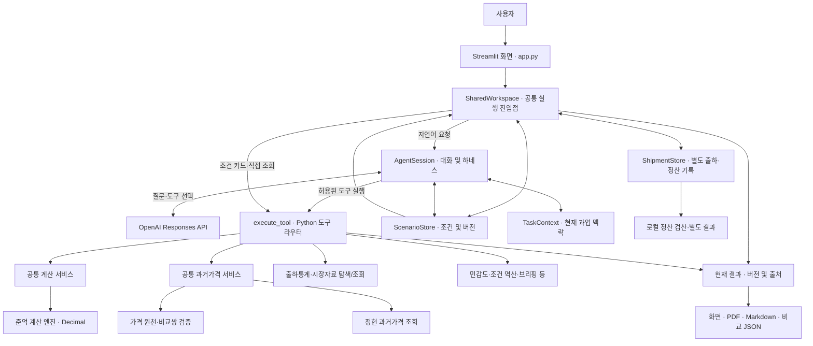

# 02. 시스템 아키텍처

> **제주 감귤 출하 의사결정 AI Agent — 팀 통합 개발본**  
> 기준일: 2026-11-11 · 브랜치: `integration/agents` · 기준 커밋: [`6517565`](https://github.com/idenist/jeju-ai-agent-project/commit/65175656e637d576056da76d5915287a2a68a84e)  
> 관련 문서: [01. 프로젝트 개요 및 현황](01_프로젝트_개요_및_현황.md)

## 1. 설계 개요

현재 시스템은 **단일 대화 Agent + Python 도구·계산 서비스 + 공통 작업 상태 + Streamlit 화면**으로 구성됩니다. 자연어 요청의 해석과 도구 선택은 모델이 담당하고, 조건 변경·데이터 조회·수치 계산·결과 저장은 Python 코드가 수행합니다.

각 팀원이 개발한 코드를 독립된 Agent 세 개로 상시 실행하는 구조는 아닙니다. **준억님의 `AgentSession`이 활성 대화 진입점**이며, 정현님의 과거 경락가격 조회 코드를 공통 서비스로 연결했습니다. 승혁님의 초기 계산 베이스라인은 독립 검산·회귀 테스트 자산으로 남아 있습니다.

### 1.1 전체 구조



도식은 **책임과 호출 경로**를 간략화한 것입니다. 실제 화면 출력은 `SharedWorkspace`에 저장된 결과와 버전 검사를 거쳐 구성되며, 모델 응답과 Python 계산값은 서로 다른 출처로 다룹니다.

## 2. 구성 요소와 책임

| 계층 | 주요 모듈 | 담당 역할 |
|---|---|---|
| **화면** | [`app.py`](../app.py) | 대화, 조건 카드, 직접 가격·출하 조회, 보고서·저장, 출하·정산 UI 제공 |
| **공유 작업공간** | [`agents/juneok/workspace.py`](../agents/juneok/workspace.py) | 대화·직접 입력이 공유하는 `AgentSession`과 계산 결과 연결, 결과 버전 관리 |
| **대화 Agent** | [`agents/juneok/agent.py`](../agents/juneok/agent.py) | 모델 호출, 도구 선택 결과 처리, 사용자 발화에 따른 실행 순서 관리 |
| **실행 하네스** | [`agents/juneok/harness.py`](../agents/juneok/harness.py) | 호출 횟수·시간·대화 길이 제한, 반복 호출 감지, 실패 분류 |
| **도구 라우터** | [`agents/juneok/tools.py`](../agents/juneok/tools.py) | 허용 도구 목록과 입력 스키마, Python 실행 대상 연결 |
| **상태·과업** | [`state.py`](../agents/juneok/state.py), [`task_context.py`](../agents/juneok/task_context.py) | 비교조건 원자 갱신·버전·입력 근거, 현재 과업의 조회조건·미확인 항목 관리 |
| **공통 서비스** | [`agents/common/`](../agents/common/) | 계산 진입점, 과거가격 연결, 데이터·응답 계약, 후속 조회 처리 |
| **업무 구현** | [`agents/juneok/`](../agents/juneok/), [`agents/jeonghyeon/price_history.py`](../agents/jeonghyeon/price_history.py) | 손익 계산, 가격 비교, 출하통계, 민감도, 역산, 브리핑·보고서·정산 |
| **독립 검산** | [`agents/baseline.py`](../agents/baseline.py) | 승혁님 초기 계산 방식에 따른 교차 검증·회귀 테스트 기준 |

### 2.1 Agent의 호출 구조

자연어 요청의 주요 경로는 다음과 같습니다.

```text
사용자 메시지
  → app.py / SharedWorkspace.run()
  → AgentSession.run()
  → 현재 ScenarioStore·TaskContext·이전 명시 조회조건을 모델 입력에 제공
  → OpenAI Responses API에서 허용 도구 선택
  → AgentSession의 호출 검사·실행 제한
  → execute_tool()에서 해당 Python 기능 실행
  → 결과·상태·필요한 확인 항목 기록
  → SharedWorkspace가 화면에 사용할 결과를 갱신
  → Streamlit에 결과·보고서 출력
```

모델에는 [`tools.py`](../agents/juneok/tools.py)의 **엄격한 도구 스키마**가 제공됩니다. 모델 호출 시 `parallel_tool_calls=False`로 실행하고, 각 도구는 필요한 시나리오 버전과 입력 필드를 점검합니다. 모델이 계산값을 자체 산출하기보다 Python이 검증한 결과를 사용자 화면에서 읽도록 구성했습니다.

### 2.2 화면에서 직접 실행하는 경로

조건 카드나 과거 가격 조회 패널은 API 키 없이 `SharedWorkspace`의 메서드를 호출합니다. 예를 들어 카드에서 비교 조건을 확정하면 다음 경로가 실행됩니다.

```text
조건 카드 적용
  → SharedWorkspace.apply_card()
  → ScenarioStore.update() · 버전 갱신
  → SharedWorkspace.calculate()
  → execute_tool("compare_shipment_options")
  → common/calculation_service.py
  → juneok/comparison.py
  → 결과 저장 및 화면 갱신
```

대화와 조건 카드가 **동일한 `ScenarioStore`**를 사용하기 때문에, 양쪽에서 확인한 조건을 기준으로 계산을 이어갈 수 있습니다.

## 3. 핵심 업무 서비스의 연결

### 3.1 출하 손익 계산

손익 계산의 서비스 진입점은 [`agents/common/calculation_service.py`](../agents/common/calculation_service.py)의 `compare_shipment_options()`입니다.

```text
도구 라우터 / 직접 비교
  → common.calculation_service.compare_shipment_options()
  → juneok.comparison.compare_shipment_options()
  → 공통 응답 상태 확인
  → 원래 계산 결과 반환
```

실제 계산은 준억님의 [`comparison.py`](../agents/juneok/comparison.py)에서 `Decimal` 기반으로 수행합니다. 수수료, 보관비, 감모, 별도 비용 등 확장된 입력을 지원하며, **승혁님의 [`baseline.py`](../agents/baseline.py)는 테스트에서 독립적으로 비교**합니다. 운영 중에 두 엔진을 동시에 실행해 결과를 선택하는 구조는 아닙니다.

민감도 비교와 조건 역산은 각각 [`sensitivity.py`](../agents/juneok/sensitivity.py), [`limits.py`](../agents/juneok/limits.py)에 구현되어 있으며, 같은 시나리오 상태를 기준으로 실행됩니다. 계산식·단위·비용 처리의 상세 규약은 `03_데이터_및_계산_명세.md`에서 정리합니다.

### 3.2 동일 규격 과거 경락가격

정현님의 가격 조회 함수는 [`agents/common/price_history_service.py`](../agents/common/price_history_service.py)를 통해 활성 Agent와 직접 조회 화면에 연결됩니다.

```text
대화 또는 직접 과거가격 조회
  → 조회조건 확인·후속 조건 처리
  → execute_tool("get_price_history")
  → get_integrated_price_history()
  → data_contract.verify_integrated_price_sources()  [조회 전]
  → jeonghyeon.price_history의 조회 코드
  → data_contract.verify_integrated_price_sources()  [조회 후]
  → result_contract의 공통 상태 변환
  → 화면·과거가격 보고서
```

조회 시 원천 가격 CSV와 비교쌍 파일의 **해시·전체 내용 일치 여부**를 점검합니다. 품종, 등급, 크기, 포장, 포장당 중량, 시장·거래방식 등의 동일 조건을 기준으로 과거 3·7·14일 가격쌍을 찾습니다.

자연어 후속 질문에서는 [`price_history_followup.py`](../agents/common/price_history_followup.py)가 이전에 사용자가 명시한 조건을 승계합니다. 최신 코드에는 **품종이 미확정이어도 나머지 입력값을 유지하는 처리**와 **포장중량 충돌 확인**이 포함되어 있습니다. 직접 조회 화면에서는 별도로 새 조회조건을 수집합니다.

정현님의 [`price_scenario.py`](../agents/jeonghyeon/price_scenario.py)는 과거 변동을 가정 단가로 변환하는 독립 모듈로 보존되어 있으며, 활성 도구 목록에는 과거가격 **조회 기능**이 연결되어 있습니다.

### 3.3 다른 자료 및 분석 기능

| 처리 영역 | 모듈 | 호출 예시 |
|---|---|---|
| 제주 과거 출하량·시장 참고가격 | [`evidence.py`](../agents/juneok/evidence.py) | `get_historical_shipment_context`, `get_market_evidence` |
| 보유 자료와 거래규격 탐색 | [`catalog.py`](../agents/juneok/catalog.py) | `explore_data` |
| 조건부 손익 민감도 | [`sensitivity.py`](../agents/juneok/sensitivity.py) | `compare_sensitivity` |
| 제안가격의 허용 조건 역산 | [`limits.py`](../agents/juneok/limits.py) | `solve_offer_limits` |
| 자료·가정 종합 검토 | [`briefing.py`](../agents/juneok/briefing.py) | `build_review_brief` |
| 판단 조건과 결과 해석 | [`insights.py`](../agents/juneok/insights.py) | `explain_decision_conditions` |
| 비교 저장본과 현재 조건 대조 | [`case_changes.py`](../agents/juneok/case_changes.py) | `review_case_changes` |

모든 도구는 [`execute_tool()`](../agents/juneok/tools.py)의 허용 목록을 통해 실행됩니다. 직접 화면 조작은 같은 Python 도구와 서비스에 접근하며, 실행 결과를 `SharedWorkspace`가 공유합니다.

## 4. 상태·결과 관리

현재 구현에서는 **조건, 과업 맥락, 최신 결과, 실제 출하 기록**을 구분해 관리합니다.

| 데이터 | 소유 객체 | 역할 |
|---|---|---|
| **비교조건** | `ScenarioStore` | 물량·현재가격·비용·보관 대안, 버전(`version`), 변경 이력·입력 출처(`provenance`) |
| **대화 및 명시 조회조건** | `AgentSession` | 모델 대화 이력, 이전 과거가격 조회 인수, 해당 데이터 버전 |
| **현재 과업 맥락** | `TaskContext` | 선택한 출하·시장 조회조건, 민감도 가정, 확인할 항목 |
| **현재 출력 결과** | `SharedWorkspace.entries` | 채널별 Python 도구 결과, 조건 버전·자료 버전과 연결된 화면 출력 |
| **실제 출하·정산** | `ShipmentStore` | 계획 기준에 연결된 별도 출하 기록과 정산 수정 이력 |

**조건 변경:** `ScenarioStore.update()`는 `expected_version`이 현재 버전과 일치할 때 변경을 적용합니다. `null` 유지와 명시적 철회를 구별하고, 보관기간이 달라지면 그 기간의 감모율을 다시 확인하도록 처리합니다.

**결과 유효성:** `SharedWorkspace.current_entries()`는 계산 시점의 조건 버전과 현재 버전, 자료 버전을 대조합니다. 조건이나 사용 자료가 달라진 상태의 결과는 최신 화면 결과로 취급하지 않습니다.

**작업 연속성:** `TaskContext`는 현재 검토의 목적, 선택한 출하·시장 조건과 미확인 항목을 관리합니다. 과거 경락가격의 “14일로 바꿔 주세요” 같은 후속 질문은 별도로 `AgentSession.price_history_query`에 보관된 **이전 명시 입력**과 결합해 처리합니다.

**별도 정산:** `ShipmentStore`는 당시 계획의 스냅샷을 연결한 후 실제 판매·공제·입금 기록을 별도로 관리합니다. 정산 금액은 로컬 UI·보고서에서 검산하며, 모델에는 처리 상태 중심의 [`model_receipt()`](../agents/juneok/settlement.py)가 전달됩니다.

## 5. 입력·출력과 데이터 경계

### 5.1 자료 흐름

```text
data/raw/ 원본 자료
  ├─ scripts/preprocess_auction.py
  │    └─ data/processed/daily_prices.csv
  │         └─ scripts/build_price_comparisons.py
  │              ├─ data/processed/price_comparisons.csv
  │              ├─ data/processed/price_comparison_availability.csv
  │              └─ data/reports/price_comparison_report.json
  └─ scripts/preprocess_shipments.py
       ├─ data/processed/daily_shipments.csv
       └─ data/processed/monthly_shipments.csv
```

위 파일들은 저장소에 포함된 가공 자료를 기준으로 합니다. 경매 자료를 추가 갱신할 때는 [`data_refresh.py`](../agents/juneok/data_refresh.py)가 별도 스냅샷을 검사하고 선택할 수 있습니다. 과거 가격쌍과 활성 시장가격 사이의 버전 일치는 별도의 검증 경로로 점검합니다.

### 5.2 결과 표시와 저장

- **화면 결과:** [`presentation.py`](../agents/juneok/presentation.py), [`reporting.py`](../agents/juneok/reporting.py), [`price_history_reporting.py`](../agents/common/price_history_reporting.py)가 Python 결과를 사용자에게 읽기 쉬운 형식으로 구성합니다.
- **PDF·Markdown:** [`pdf_report.py`](../agents/juneok/pdf_report.py) 및 보고서 생성 코드가 현재 확정된 결과를 문서로 출력합니다.
- **비교 JSON:** [`casefiles.py`](../agents/juneok/casefiles.py)가 조건 스냅샷·이력·조회 결과·해시를 저장하며, 복원 시 현재 자료를 기준으로 다시 계산합니다.
- **정산 결과:** [`settlement.py`](../agents/juneok/settlement.py)와 정산 전용 UI·보고서가 별도 출하 기록을 관리합니다.

현재 [`app.py`](../app.py)는 조회·계산·보고서 갱신 이후 비교 JSON 다운로드 데이터를 생성하는 순서로 구성되어 있습니다. 화면 전환 시 저장 내용이 직전 결과에 머무르던 문제를 개선한 부분입니다.

## 6. 실행 안정성에 관한 설계

대화 실행의 기본 정책은 [`ExecutionPolicy`](../agents/juneok/harness.py)에 정의되어 있습니다.

| 항목 | 기본값 |
|---|---:|
| 모델 요청 | 최대 6회/사용자 요청 |
| Python 도구 호출 | 최대 12회/사용자 요청 |
| 처리 시간 예산 | 90초 |
| 유지하는 완결 사용자 턴 | 최근 4개 |
| 직렬화한 대화 입력 | 최대 32,000자 기준 |
| 동일 상태·동일 인수의 반복 도구 호출 | 2회까지 허용 |

하네스는 모델 요청 실패, 인증·연결 문제, 반복 호출, 입력·시간 예산 초과를 구분하고, 확인된 부분 결과를 화면에 전달하도록 설계되어 있습니다. 이 시간 예산은 **전체 실행 흐름에서 확인하는 상한**이며 개별 로컬 작업을 강제 종료하는 실행 샌드박스는 아닙니다.

모델 호출에는 현재 확인된 시나리오·과업 맥락이 포함됩니다. 반면 과거 가격의 세부 관측값과 정산 카드의 상세 금액은 도구 결과를 모델에 전달할 때 각각 [`price_history_model_receipt()`](../agents/common/price_history_service.py), [`model_receipt()`](../agents/juneok/settlement.py)로 축약합니다. 이 구분은 모델 대화와 로컬 분석 결과의 정보 범위를 이해할 때 중요합니다.

## 7. 새 개발자가 코드를 읽는 순서

1. [`app.py`](../app.py): 화면과 사용자 진입점, 직접 조회·저장 순서
2. [`workspace.py`](../agents/juneok/workspace.py) 및 [`state.py`](../agents/juneok/state.py): 공유 조건과 결과 상태
3. [`agent.py`](../agents/juneok/agent.py) 및 [`tools.py`](../agents/juneok/tools.py): 모델 도구 선택과 Python 실행 경로
4. [`calculation_service.py`](../agents/common/calculation_service.py) → [`comparison.py`](../agents/juneok/comparison.py): 손익 계산 경로
5. [`price_history_service.py`](../agents/common/price_history_service.py) → [`price_history.py`](../agents/jeonghyeon/price_history.py): 과거 경락가격 조회 경로
6. [`data_contract.py`](../agents/common/data_contract.py)와 [`result_contract.py`](../agents/common/result_contract.py): 원천 버전·상태 계약
7. [`tests/`](../tests/), [`evals/`](../evals/), [`scripts/evaluate_integrated_agent.py`](../scripts/evaluate_integrated_agent.py): 회귀 및 실제 모델 평가

---

**문서 범위:** 이 문서는 현재의 책임 분리와 실행 경로를 설명합니다. 원본 데이터의 필드·계산식·품질 검증 규칙은 `03_데이터_및_계산_명세.md`, 설치·실행 및 검증 명령은 후속 운영·평가 문서에서 정리합니다.
