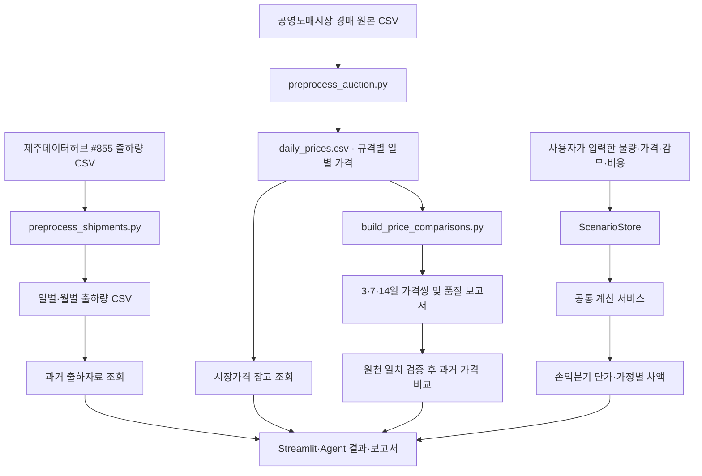

# 03. 데이터 및 계산 명세

> **제주 감귤 출하 의사결정 AI Agent — 팀 통합 개발본**  
> 기준일: 2026-11-11 · 브랜치: `integration/agents` · 기준 커밋: [`6517565`](https://github.com/idenist/jeju-ai-agent-project/commit/65175656e637d576056da76d5915287a2a68a84e)  
> 관련 문서: [01. 프로젝트 개요 및 현황](01_프로젝트_개요_및_현황.md) · [02. 시스템 아키텍처](02_시스템_아키텍처.md)

## 1. 먼저 이해할 것: 어떤 데이터로 무엇을 계산하나요?

이 프로젝트에서 사용하는 숫자는 크게 세 종류입니다.

| 종류 | 쉽게 설명하면 | 예시 | 사용하는 기능 |
|---|---|---|---|
| **제주 출하통계** | 과거에 신고된 감귤 출하 물량 | 2024년 11월 노지온주 출하량(톤) | 연도·품종·월별 출하 흐름 조회 |
| **도매시장 경락가격** | 도매시장에서 과거 실제로 관측된 거래가격 | 2026-10-08 가락시장 특정 규격의 원/kg | 시장가격 참고, 동일 규격의 과거 3·7·14일 비교 |
| **사용자 비교조건** | 농가가 알고 있거나 직접 가정한 값 | 물량 3,000kg, 현재 단가 3,000원/kg, 감모율 2% | 출하 대안의 손익분기 가격·차액 계산 |

**핵심 구분:** 출하 손익 계산의 현재 판매단가와 비용은 사용자의 비교조건에서 가져옵니다. 과거 시장가격은 별도의 근거 자료로 조회합니다. 따라서 사용자가 “지난주 시장가격이 얼마였나요?”라고 물었을 때와 “7일 보관하려면 얼마에 팔아야 하나요?”라고 물었을 때 사용하는 데이터와 계산 경로가 다릅니다.

아래에서는 **원천 데이터 → 가공 데이터 → 조회 → 손익 계산** 순서로 설명합니다. `CSV`는 쉼표로 구분된 표 파일, `전처리`는 원본을 검사하고 분석 가능한 형태로 정리하는 작업입니다.

## 2. 데이터가 만들어지는 과정

### 2.1 전체 흐름



그림에서 출하통계와 시장가격은 **자료 조회 경로**, 사용자 조건은 **손익 계산 경로**입니다. 통합 Agent는 질문에 맞는 도구를 선택하고 결과를 함께 보여줍니다.

### 2.2 제주 출하량: 원본부터 월별 통계까지

원천은 [제주데이터허브 #855 — 신고소별 감귤류 및 만감류 출하량 통계](https://www.jejudatahub.net/data/view/data/855)입니다.

| 단계 | 파일 | 의미 |
|---|---|---|
| 원본 | [`data/raw/jeju_shipments.csv`](../data/raw/jeju_shipments.csv) | `출하일자`, `품종대분류`, `품종소분류`, `신고소`, `출하량` 5개 주요 필드 |
| 전처리 | [`scripts/preprocess_shipments.py`](../scripts/preprocess_shipments.py) | 인코딩·날짜·물량 검증, 신고소별 행을 일/월 단위로 집계 |
| 일별 결과 | [`data/processed/daily_shipments.csv`](../data/processed/daily_shipments.csv) | 날짜 × 품종별 출하량(톤) |
| 월별 결과 | [`data/processed/monthly_shipments.csv`](../data/processed/monthly_shipments.csv) | 연월 × 품종별 출하량(톤), 관측일 수 포함 |
| 품질 기록 | [`data/reports/shipment_quality_report.json`](../data/reports/shipment_quality_report.json) | 날짜 누락·원본 행 수·관측 범위·집계 일치 여부 |
| 미배정 기록 | [`data/reports/shipment_unassigned_rows.csv`](../data/reports/shipment_unassigned_rows.csv) | 날짜 부족 등으로 특정 월에 배정할 수 없었던 원본 행 |

**전처리 예시:** 같은 날짜·품종에 여러 신고소의 물량이 있으면 이를 합쳐 날짜별 출하량을 만듭니다. 월별 파일은 해당 월에 날짜가 확인된 출하량을 합산하며, `observed_days`로 실제 기록이 있는 일수를 함께 표시합니다.

저장소의 품질 보고서 기준 결과는 다음과 같습니다.

| 항목 | 수치 |
|---|---:|
| 원본 행 | 46,836 |
| 날짜가 확인된 행 | 44,886 |
| 날짜 누락으로 월 배정에서 제외된 행 | 1,950 |
| 일별 집계 행 | 7,481 |
| 월별 집계 행 | 304 |
| 날짜가 확인된 원본 범위 | 2018-01-01 ~ 2025-09-17 |

날짜가 누락된 1,950행은 한라봉 기록이며, 날짜를 알 수 없는 물량 **21,617.86톤**은 별도 기록에 남습니다. 2025년 9월도 17일까지의 **부분월**이라는 표시가 있습니다. 이 구분 덕분에 사용자는 2025년 9월 총량을 완전한 월간 통계로 오해하지 않고 해석할 수 있습니다.

월별 조회는 [`get_historical_shipment_context()`](../agents/juneok/evidence.py)가 수행합니다. 품종·월·연도 범위를 받으며, 자료에 없는 연도는 결과에서 빠지고 부분월은 품질 경고에 반영됩니다.

### 2.3 경매가격: 원본 거래에서 원/kg 가격까지

원천은 [전국 공영도매시장 경매원천정보](https://www.data.go.kr/data/15141810/openapi.do)에서 확보한 CSV입니다. 저장소의 공통 동결본은 **서울 가락시장 감귤 거래, 2026-10-01 ~ 2026-11-03**을 대상으로 합니다.

| 단계 | 파일 | 의미 |
|---|---|---|
| 원본 | [`data/raw/auction_trades.csv`](../data/raw/auction_trades.csv) | 거래일·시장·품종·등급·크기·포장·중량·거래금액이 담긴 경매 거래행 |
| 전처리 | [`scripts/preprocess_auction.py`](../scripts/preprocess_auction.py) | 거래 조건·중량·금액을 검증하고 같은 날짜·규격으로 묶어 집계 |
| 규격별 결과 | [`data/processed/daily_prices.csv`](../data/processed/daily_prices.csv) | 날짜와 **시장·품종·등급·크기·포장·중량·거래방식**이 일치하는 가격 |
| 품종별 참고 | [`data/processed/daily_variety_prices.csv`](../data/processed/daily_variety_prices.csv) | 등급·크기 등을 합쳐 보는 품종별 요약 |
| 품질 기록 | [`data/reports/auction_quality_report.json`](../data/reports/auction_quality_report.json) | 제외 사유, 품질 경고, 관측일·집계 건수 |

여기서 **경락가격**은 도매시장 거래에서 형성된 가격입니다. 농가가 제시받은 판매단가나 실제 정산 뒤 받은 금액과는 개념이 다릅니다.

동일 규격·동일 일자의 원/kg 가격은 다음과 같이 계산합니다.

$$
\text{평균 경락가격(원/kg)}=\frac{\text{해당 집계의 총거래금액(원)}}{\text{해당 집계의 총거래중량(kg)}}
$$

예를 들어 100kg이 총 300,000원, 200kg이 총 640,000원에 거래됐다면 집계 평균은 `(300,000 + 640,000) ÷ (100 + 200) = 3,133.33…원/kg`입니다. 단순히 두 거래의 단가를 평균 내는 대신 **거래중량을 반영하는 가중평균**입니다. *이 숫자는 계산 방법을 보여주는 가상 예시입니다.*

공통 동결본의 품질 보고서에는 원본 **32,749행**, 채택 **30,929행**, 제외 **1,820행**, 규격별 가격 **1,592행**, 품종별 요약 **184행**이 기록되어 있습니다. 거래일은 총 28일에 유효 관측값이 있으며, 자료의 실제 날짜 범위는 위 표와 같습니다.

### 2.4 규격이 같다는 것은 무엇을 의미하나요?

서로 다른 날짜의 가격을 비교할 때에는 “감귤”이라는 이름만 같아서는 충분하지 않습니다. 예를 들어 조생귤 `특·소·상자 5kg`과 조생귤 `상·중·망 10kg`은 가격에 영향을 주는 거래조건이 다릅니다.

가격 비교의 기준인 **동일 거래규격 키**는 다음 7개 필드입니다.

| 필드 | 뜻 | 예시 |
|---|---|---|
| `market_code` | 도매시장 코드 | `110001` |
| `variety_code` | 원천 품종 코드 | `01` (조생귤) |
| `grade_code` | 원천 등급 코드 | 원본에 기록된 코드 |
| `size_code` | 원천 크기 코드 | 원본에 기록된 코드 |
| `package` | 포장 종류 | `상자` |
| `package_kg` | 포장 한 개의 중량 | `5` |
| `trade_type` | 거래방식 | `경매` |

코드로 식별하는 항목은 표시명이 같더라도 원천 코드가 다르면 구별합니다. `package_kg`는 숫자로 비교하며 `5`와 `5.0`은 같은 중량으로 취급합니다. 이 규칙은 [`agents/common/data_contract.py`](../agents/common/data_contract.py)의 `MARKET_KEY_FIELDS`, `market_key()`에 있습니다.

### 2.5 과거 3·7·14일 가격쌍은 어떻게 만드나요?

[`scripts/build_price_comparisons.py`](../scripts/build_price_comparisons.py)는 `daily_prices.csv`의 각 행을 기준일로 삼아 **정확히 3일·7일·14일 뒤**에 같은 거래규격의 가격이 있는지 찾습니다. 여기서 7일은 *달력상 7일*이며, 거래가 열린 날 7번을 세는 방식이 아닙니다.

```text
예시: 기준일 2026-10-01 · 7일 간격
  → 비교일 2026-10-08
  → 같은 시장·품종코드·등급코드·크기코드·포장·중량·거래방식의 기록 검색
  → 두 가격이 있으면 가격 차이·변동률 계산
  → 없으면 관측범위 밖 / 해당 일자 관측 없음 / 동일 조건 없음으로 구분
```

가격쌍의 계산식은 다음과 같습니다.

$$
\text{가격 차이}=P_{\text{비교일}}-P_{\text{기준일}},\qquad
\text{변동률(\%)}=\left(\frac{P_{\text{비교일}}}{P_{\text{기준일}}}-1\right)\times100
$$

예를 들어 기준일 2,000원/kg, 비교일 2,200원/kg이라면 차이는 `+200원/kg`, 변동률은 `+10%`입니다. *이 역시 이해를 돕기 위한 가상 예시입니다.* 실제 코드에서는 정제 CSV의 가격 표시값을 기준으로 변동률을 계산합니다.

| 결과 파일 | 내용 |
|---|---|
| [`price_comparisons.csv`](../data/processed/price_comparisons.csv) | 양쪽 날짜에 가격이 있어서 실제로 비교할 수 있었던 가격쌍. 품질 경고가 있는 쌍도 포함 |
| [`price_comparison_availability.csv`](../data/processed/price_comparison_availability.csv) | 비교 성공·경고·자료 부족을 포함한 **전체 비교 시도** |
| [`price_comparison_report.json`](../data/reports/price_comparison_report.json) | 간격별 결과 건수와 비교 불가 사유·품질 집계 |

저장소의 가격 비교 보고서 기준:

| 비교 간격 | 전체 시도 | 가격쌍 발견 | 그중 경고 없는 쌍 | 비교 불가 |
|---|---:|---:|---:|---:|
| 3일 | 1,592 | 843 | 291 | 749 |
| 7일 | 1,592 | 850 | 290 | 742 |
| 14일 | 1,592 | 606 | 214 | 986 |
| **합계** | **4,776** | **2,299** | **795** | **2,477** |

따라서 **2,299행은 가격이 발견된 쌍 전체**, **795행은 그중 품질 경고가 없는 쌍**입니다. 두 숫자는 다른 의미입니다.

조회 도구 [`agents/jeonghyeon/price_history.py`](../agents/jeonghyeon/price_history.py)는 경고 없는 쌍을 기본 가격 변화 사례로 보여주고, 경고가 있는 쌍·비교 불가 사례의 수와 사유도 함께 제시합니다.

## 3. 데이터 조회에서 사용하는 주요 필드

원본에는 많은 열이 있지만, 팀원이 조회 결과를 이해할 때 가장 중요한 필드는 다음과 같습니다.

| 필드 | 출처·뜻 | 읽는 방법 |
|---|---|---|
| `shipment_tons` | 제주 출하 신고량(톤) | `100.50`이면 신고 출하량 100.50톤 |
| `observed_days` | 해당 월의 기록이 있는 날짜 수 | 한 달 전체를 관측했는지 해석할 때 참고 |
| `data_warning` | 출하량 자료의 품질 표시 | 부분월이나 날짜 미배정 기록 등의 영향 |
| `avg_price_kg` | 날짜·규격별 평균 경락가격(원/kg) | 집계 금액 ÷ 집계 중량 |
| `transaction_count` | 집계에 포함된 거래 건수 | 표본 규모 참고 |
| `quality_flag` | 가격 자료의 품질 표시 | 거래 부족·등급/크기 미상 등 |
| `base_date`, `target_date` | 과거 가격쌍의 두 관측 날짜 | 기준일과 기준일+간격 |
| `comparison_status` | 가격쌍 상태 | `COMPARABLE`, `COMPARABLE_WITH_WARNINGS`, `UNAVAILABLE` |
| `unavailable_reason` | 비교 불가 사유 | 관측 범위 밖, 해당 날짜 관측 없음, 같은 거래조건 없음 |

예를 들어 `2026-11-03`의 어떤 규격에서 거래가 없으면 그 사실은 `0원/kg`이라는 가격과 다릅니다. 가격 자료가 부족한 경우에는 사유를 별도로 표시하며, 화면에서 관측 범위와 품질 정보를 함께 확인할 수 있습니다.

## 4. 출하 손익 계산: 입력값의 의미

과거 시장가격을 조회하는 단계와 달리, 출하 손익 계산은 **사용자가 확인한 판매조건**에서 시작합니다. 실행 경로는 다음과 같습니다.

```text
사용자 조건 입력
  → ScenarioStore(현재 조건 저장)
  → tools.py의 compare_shipment_options
  → agents/common/calculation_service.py
  → agents/juneok/comparison.py(실제 계산)
  → 숫자·상태 반환
  → SharedWorkspace 및 화면·보고서에 반영
```

### 4.1 핵심 입력 항목

| 코드 필드 | 쉬운 뜻 | 예시 |
|---|---|---|
| `quantity_kg` | 현재 비교할 감귤 물량(kg) | `3000` |
| `current_price_per_kg` | 지금 판매한다고 가정한 단가(원/kg) | `3000` |
| `price_basis` | 단가가 판매수수료 차감 전인지 후인지 | `commission_net` / `gross` |
| `current_fee_percent` | 현재 출하 시 수수료율 | `5`라면 5% |
| `cost_policy` | 별도 비용을 어떻게 비교할지 | `equal_excluded` / `itemized` |
| `included_costs` | 이미 단가에 반영됐다고 확인한 비용 항목 | `commission`, `storage` 등 |
| `current_costs` | 지금 출하할 경우 별도로 드는 비용 목록 | 운송비·선별비 등 |
| `options` | 보관 후 판매를 비교할 대안 목록 | 7일 보관, 14일 보관 등 최대 3개 |
| `storage_available` | 사용자가 확인한 저장시설 이용 가능 여부 | 예/아니오/미확인 |
| `shipping_flexible` | 사용자가 확인한 출하 일정 조정 가능 여부 | 예/아니오/미확인 |

`options` 안의 주요 필드는 다음과 같습니다.

| 필드 | 뜻 |
|---|---|
| `delay_days` | 보관기간(일). 1~365일의 지연 대안 |
| `loss_percent` | **그 기간 전체에 걸친** 감모율(%) |
| `daily_storage_cost` | 비교하는 **전체 물량**의 하루 추가 보관비(원/일) |
| `fee_percent` | 해당 대안의 판매수수료율(%) |
| `future_price_per_kg` | 사용자가 직접 입력한 미래 판매단가 가정(원/kg) |
| `costs` | 해당 대안에 추가되는 항목별 비용 목록 |
| `loss_confirmed_for_period` | 보관기간을 바꿀 때 감모 가정을 다시 확인하기 위한 입력 표시 |

수수료와 비용은 특히 주의해서 읽어야 합니다.

- **`commission_net`**: 이미 수수료를 차감한 단가입니다. 계산식에서는 수수료율을 0으로 봅니다.
- **`gross`**: 수수료 차감 전 단가입니다. 현재 출하와 보관 대안의 수수료율을 각각 적용합니다.
- **`equal_excluded`**: 보관비 외 비용이 양쪽에서 동일하다고 확인한 경우, 비교에 영향을 주지 않는 비용은 제외하는 방식입니다.
- **`itemized`**: 현재 출하와 보관 대안에 드는 별도 비용을 항목별로 입력하는 방식입니다.

여기서 `included_costs`는 같은 항목을 **단가와 별도 비용에서 이중 차감하는 실수**를 막는 데 사용합니다. 입력되지 않은 값(`null`)과 사용자가 실제 0이라고 확인한 값(`0`)도 구별합니다. 구현은 [`validate_partial()`](../agents/juneok/comparison.py)에 있습니다.

### 4.2 0일 기준과 보관 대안

비교는 **0일 기준(현재 판매 시 비교금액)**과 **1~365일 보관 대안(최대 3개)**을 나란히 놓습니다. 0일은 계산상의 기준이며, 실제로 오늘 출하할 수 있는지는 저장시설·계약·운송 상황과 함께 판단합니다.

일반적으로 “7일 보관”의 감모율 2%는 하루 2%씩 빠진다는 뜻이 아니라 **7일을 보관한 뒤 전체 물량 중 2%가 줄어드는 가정**입니다. 따라서 보관기간을 14일로 바꾸면 그 기간에 맞는 감모율을 다시 확인하도록 [`ScenarioStore`](../agents/juneok/state.py)가 처리합니다.

## 5. 출하 손익분기 계산식

### 5.1 용어와 기호

| 기호 | 의미 |
|---|---|
| `Q` | 현재 물량(kg) |
| `P₀` | 현재 판매단가(원/kg) |
| `f₀` | 현재 출하 수수료율(소수: 5%라면 0.05) |
| `C₀` | 현재 출하 시 별도로 차감할 비용(원) |
| `d` | 보관기간(일) |
| `r` | 해당 보관기간 전체 감모율(소수: 2%라면 0.02) |
| `S` | 전체 물량의 하루 보관비(원/일) |
| `f₁` | 보관 후 판매 수수료율 |
| `C₁` | 보관 대안의 별도 비용(원) |
| `P₁` | 사용자가 가정한 보관 후 판매단가(원/kg) |

**① 현재 판매 시 비교금액**

$$
N_0 = Q\times P_0\times(1-f_0)-C_0
$$

**② 보관 후 판매 가능한 중량**

$$
Q_1 = Q\times(1-r)
$$

**③ 보관 후 추가로 드는 비용**

$$
C_{\mathrm{delay}}=d\times S+C_1
$$

**④ 사용자가 미래 판매단가 `P₁`를 정했을 때 보관 후 비교금액**

$$
N_1(P_1)=Q_1\times P_1\times(1-f_1)-C_{\mathrm{delay}}
$$

**⑤ 손익분기 판매단가: 보관 후 비교금액이 현재 비교금액과 같아지는 가격**

$$
P_{\mathrm{BE}}=\max\left(0,\frac{N_0+C_{\mathrm{delay}}}{Q_1\times(1-f_1)}\right)
$$

코드는 `Decimal`로 계산하고, 사용자에게 보여주는 **최소 정수 원/kg**은 손익분기 단가를 올림(`ROUND_CEILING`)해 표시합니다. 가정 미래단가가 입력되어 있다면 차액은 `N₁ − N₀`입니다.

`N₀`, `N₁`은 **입력한 가격과 비용 범위에서 계산한 비교금액**입니다. 농가의 모든 생산비를 포함한 회계상 순이익을 뜻하지는 않습니다.

### 5.2 실제 계산 예시: 3,000kg을 7일 보관하면?

다음은 저장소의 기본 시연 조건을 사용한 **가상 사례**입니다. 수수료 차감 후 단가를 사용하며, 보관비 외 비용은 양쪽에서 동일하다고 확인한 조건입니다.

| 항목 | 값 |
|---|---:|
| 현재 물량 `Q` | 3,000kg |
| 현재 판매단가 `P₀` | 3,000원/kg |
| 보관기간 `d` | 7일 |
| 기간 전체 감모율 `r` | 2% |
| 하루 보관비 `S` | 20,000원/일 |
| 추가 수수료·별도 비용 | 0원 |

**1단계 — 지금 판매 기준:** `3,000kg × 3,000원 = 9,000,000원`

**2단계 — 보관 후 남는 물량:** `3,000kg × (1 − 0.02) = 2,940kg`

**3단계 — 보관비:** `20,000원 × 7일 = 140,000원`

**4단계 — 필요한 판매가격:**

$$
\frac{9,000,000+140,000}{2,940}=3,108.8435\ldots\;\text{원/kg}
$$

따라서 **최소 정수 판매단가는 3,109원/kg**입니다.

같은 조건에서 감모율만 **4%**로 바꾸면 남는 물량은 2,880kg이고, 손익분기 가격은 `9,140,000 ÷ 2,880 = 3,173.6111…원/kg`이므로 **3,174원/kg**으로 표시합니다.

이번에는 사용자가 **7일 뒤 3,300원/kg에 판매할 수 있다고 가정**했다고 해보겠습니다. 감모율 2%라면:

- 보관 후 비교금액: `2,940kg × 3,300원 − 140,000원 = 9,562,000원`
- 현재 기준과의 차액: `9,562,000원 − 9,000,000원 = +562,000원`

이 결과는 **3,300원이라는 가정이 실현될 때의 조건부 차액**입니다. 실제 판매가격을 예측해서 만든 숫자는 아닙니다.

### 5.3 수수료·항목별 비용이 있으면?

수수료 차감 전(`gross`) 단가를 사용하면 현재 판매와 보관 후 판매의 수수료율을 **각각 계산**합니다. 예를 들어 현재 판매단가가 3,000원/kg이고 수수료율이 5%라면, 별도 비용을 차감하기 전 기준은 `3,000 × 0.95 = 2,850원/kg`입니다.

`itemized`를 선택한 경우에는 선별·포장·운송·보관·기타 비용을 현재 출하와 보관 대안에 나눠 입력합니다. `included_costs`에 이미 포함된 항목은 별도 비용과 중복되지 않는지 검사합니다.

실제 계산은 [`agents/common/calculation_service.py`](../agents/common/calculation_service.py)가 [`agents/juneok/comparison.py`](../agents/juneok/comparison.py)의 `compare_shipment_options()`로 연결합니다. 승혁님의 [`agents/baseline.py`](../agents/baseline.py)는 기본 조건의 **독립 검산 기준**으로 활용합니다.

## 6. 계산을 활용하는 추가 기능

### 6.1 민감도 분석: 여러 가정을 한 번에 비교

**민감도 분석**은 하나의 보관 대안에서 감모율과 미래 판매단가를 여러 값으로 바꿔, 어떤 조건에서 비교금액이 달라지는지 보는 기능입니다.

예를 들어 7일 보관 대안에 다음 가정을 넣을 수 있습니다.

- 감모율: **2%, 3%, 4%**
- 미래 판매단가: **3,200원, 3,300원**

그러면 총 **3 × 2 = 6개 조합**을 같은 계산식으로 다시 계산합니다. 감모율과 판매단가는 각각 최대 7개이므로 최대 49개 조합을 비교할 수 있습니다. 원래 저장된 시나리오를 덮어쓰지 않고 복사본을 계산합니다.

구현: [`agents/juneok/sensitivity.py`](../agents/juneok/sensitivity.py)

### 6.2 조건 역산: 얼마까지 감당할 수 있나요?

**조건 역산**은 미래 판매단가를 사용자가 제시했을 때, 그 단가에서 손익이 같아지는 **허용 감모율 또는 하루 보관비 상한**을 거꾸로 구하는 기능입니다. 한 번에 한 변수만 바꾸고 나머지 조건은 고정합니다.

앞서 사용한 3,000kg·7일·현재 단가 3,000원·하루 보관비 20,000원 조건에서 **가정 미래단가를 3,300원/kg**으로 두면:

| 무엇을 구하나요? | 고정한 조건 | 계산 결과 |
|---|---|---:|
| 허용 감모율 상한 | 하루 보관비 20,000원 유지 | **7.67%** (소수 둘째 자리 이하 버림) |
| 하루 보관비 상한 | 기간 전체 감모율 2% 유지 | **100,285원/일** (정수 원 단위 버림) |

이는 각 변수를 **따로 계산한 결과**입니다. 구현은 [`agents/juneok/limits.py`](../agents/juneok/limits.py)이며, 경계값은 더 유리하게 보이지 않도록 보수적으로 내림(`ROUND_FLOOR`)해 표시합니다.

## 7. 조회 결과는 어떻게 계산 결과와 연결되나요?

### 7.1 시장 참고가격과 과거 가격쌍의 차이

두 기능은 모두 경매 데이터를 사용하지만 조회 기준이 다릅니다.

| 기능 | 찾는 값 | 주요 실행 함수 |
|---|---|---|
| **시장 참고가격** | 사용자가 지정한 거래규격에 맞는, 기준일 이전의 최근 관측가격 | [`get_market_evidence()`](../agents/juneok/evidence.py) |
| **과거 가격쌍** | 같은 거래규격의 정확한 3·7·14일 간격 두 관측가격과 변화 | [`get_integrated_price_history()`](../agents/common/price_history_service.py) |

시장 참고가격은 선택한 날짜의 집계 금액과 중량에서 가중평균을 계산합니다. 과거 가격쌍은 미리 생성된 비교표와 원천 자료를 검증한 뒤 정현님의 조회 함수로 전달합니다. 비교할 품종·등급·크기·포장 등이 부족하면 확인할 항목과 후보를 표시합니다.

일반적인 조회 예시는 다음과 같습니다.

```text
사용자: "조생귤 특·소, 상자 5kg의 과거 7일 가격을 비교해 주세요."
  → get_price_history 선택
  → 조건 정리: variety=조생귤, grade=특, size=소, package=상자, package_kg=5
  → 데이터 원천·비교표 일치 확인
  → 해당 규격의 과거 7일 가격쌍 검색
  → 비교 가능한 관측값과 품질·출처를 화면에 표시
```

대화 중 “그럼 14일로 바꿔줘”라고 하면 [`price_history_followup.py`](../agents/common/price_history_followup.py)가 **사용자가 앞서 명시한 조회조건**을 이어받습니다. 예를 들어 포장중량이 `10kg`과 `5kg`으로 충돌할 때에는 중량을 확인한 뒤 조회를 이어갑니다.

### 7.2 조회 결과의 상태값

도구는 숫자 외에도 **이번 작업을 어디까지 수행했는지** 알려주는 상태를 반환합니다.

| 상태 | 뜻 | 화면에서의 처리 예시 |
|---|---|---|
| `OK` | 필요한 값을 확인해 계산·조회 완료 | 숫자와 근거 표시 |
| `NEEDS_INPUT` | 필요한 사용자 조건이 남음 | 빠진 품종·규격·감모 등의 확인 요청 |
| `NO_DATA` | 지정 조건에 해당하는 관측자료가 없음 | 관측기간·조건 및 자료 부족 사유 안내 |
| `INVALID_INPUT` | 값의 형식·범위가 잘못되거나 조건이 충돌함 | 입력값 수정 안내 |
| `DATA_ERROR` | 파일·원천 버전·결과 검증에 문제가 있음 | 자료 점검 안내 |
| `PARTIAL` / `CHECK_REQUIRED` | 종합 검토 일부만 완료되었거나 확인사항이 남음 | 완료 항목과 미확인 항목을 나눠 표시 |

원래 조회 도구의 상태와 공통 상태 사이의 변환은 [`agents/common/result_contract.py`](../agents/common/result_contract.py)가 담당합니다. 예를 들어 정현님 도구의 `NEEDS_CLARIFICATION`은 통합 응답에서 `NEEDS_INPUT`으로 표현하되, 원래 상태는 `source_status`에 보존합니다.

## 8. 데이터가 바뀌었을 때 신뢰성을 유지하는 방법

### 8.1 버전과 내용 검증

데이터 가공에서 중요한 것은 **파일이 존재한다는 사실**과 **서로 같은 원천에서 생성됐다는 사실**을 구분하는 것입니다.

- [`data/metadata/juneok_manifest.json`](../data/metadata/juneok_manifest.json)은 공통 원천·가공 데이터의 파일 정보와 SHA-256을 기록합니다. SHA-256은 파일 내용을 식별하는 해시값입니다.
- [`verify_price_pair_sources()`](../agents/common/data_contract.py)는 시장가격 원천과 과거 가격쌍의 파일 구조·건수·버전 일치 여부를 확인합니다.
- [`verify_integrated_price_sources()`](../agents/common/data_contract.py)는 원본 `daily_prices.csv`에서 **4,776개 비교 시도를 메모리에서 다시 생성해** CSV의 모든 비교 행과 집계 보고서를 대조합니다.
- [`get_integrated_price_history()`](../agents/common/price_history_service.py)는 조회 전후의 검증 결과를 확인하고, 검증된 가격쌍을 사용합니다.

이 검증을 도입한 이유는 **행 수가 동일해도 중간 가격이나 변동률 하나가 바뀌면 결론이 달라질 수 있기 때문**입니다.

### 8.2 별도 가격 스냅샷과 운영 과제

준억님 구현에는 새로운 경매 CSV를 별도 공간에서 검사한 뒤 선택 적용하는 기능이 있습니다. 관련 코드는 [`agents/juneok/data_refresh.py`](../agents/juneok/data_refresh.py)이며, 선택 스냅샷은 `artifacts/data-refresh/`, 활성 선택 정보는 `artifacts/market-active.json`에 관리됩니다.

현재 과거 가격쌍은 **공통 동결 원천 기준**으로 생성되어 있습니다. 따라서 새로운 시장가격 스냅샷을 적용하는 운영 절차에는 **해당 원천을 기준으로 가격쌍과 보고서를 함께 재생성·검증하는 단계**가 필요합니다.

또한 [`TaskContext.data_revision()`](../agents/juneok/task_context.py)이 파일 해시와 함께 선택 경로 문자열을 버전 식별에 사용하므로, **PC만 바뀌고 데이터 내용은 같은 경우**에도 비교 JSON 복원 시 변경으로 표시될 수 있습니다. 이 항목은 향후 자료 버전 판정 방식의 개선 대상으로 남아 있습니다.

위 두 항목은 **현재 구현 상태를 이해하기 위해 알아둘 운영 쟁점**이며, 해결 우선순위와 작업 분담은 향후 개발 계획서에서 정리합니다.

## 9. 코드에서 확인할 위치

| 알고 싶은 내용 | 코드·자료 |
|---|---|
| 경매가격 원본 검증·집계 | [`scripts/preprocess_auction.py`](../scripts/preprocess_auction.py), [`auction_quality_report.json`](../data/reports/auction_quality_report.json) |
| 제주 출하량 전처리 | [`scripts/preprocess_shipments.py`](../scripts/preprocess_shipments.py), [`shipment_quality_report.json`](../data/reports/shipment_quality_report.json) |
| 3·7·14일 가격쌍 생성 | [`scripts/build_price_comparisons.py`](../scripts/build_price_comparisons.py), [`price_comparison_report.json`](../data/reports/price_comparison_report.json) |
| 통합 가격 데이터 계약 | [`agents/common/data_contract.py`](../agents/common/data_contract.py) |
| 경매가격 직접 조회 | [`agents/juneok/evidence.py`](../agents/juneok/evidence.py) |
| 과거 가격쌍 조회 | [`agents/common/price_history_service.py`](../agents/common/price_history_service.py), [`agents/jeonghyeon/price_history.py`](../agents/jeonghyeon/price_history.py) |
| 출하 비교조건 검증·계산식 | [`agents/juneok/comparison.py`](../agents/juneok/comparison.py) |
| 공통 계산 진입점 | [`agents/common/calculation_service.py`](../agents/common/calculation_service.py) |
| 민감도·허용 조건 역산 | [`agents/juneok/sensitivity.py`](../agents/juneok/sensitivity.py), [`agents/juneok/limits.py`](../agents/juneok/limits.py) |
| 사용자 조건·자료 버전 | [`agents/juneok/state.py`](../agents/juneok/state.py), [`agents/juneok/task_context.py`](../agents/juneok/task_context.py) |

---

**문서 관리:** 이 명세의 수치와 코드 경로는 기준 커밋 `6517565`의 저장소 데이터·구현을 토대로 작성했습니다. **3,000kg 사례와 2,000→2,200원 사례는 가상 설명용 수치**입니다. 원천 파일이 갱신되면 관측기간·행 수·가격쌍 건수·검증 결과도 함께 갱신해야 합니다. 설치·테스트 명령과 최신 실제 모델 평가는 각각 후속 사용자 가이드 및 테스트·평가 문서에서 다룹니다.
